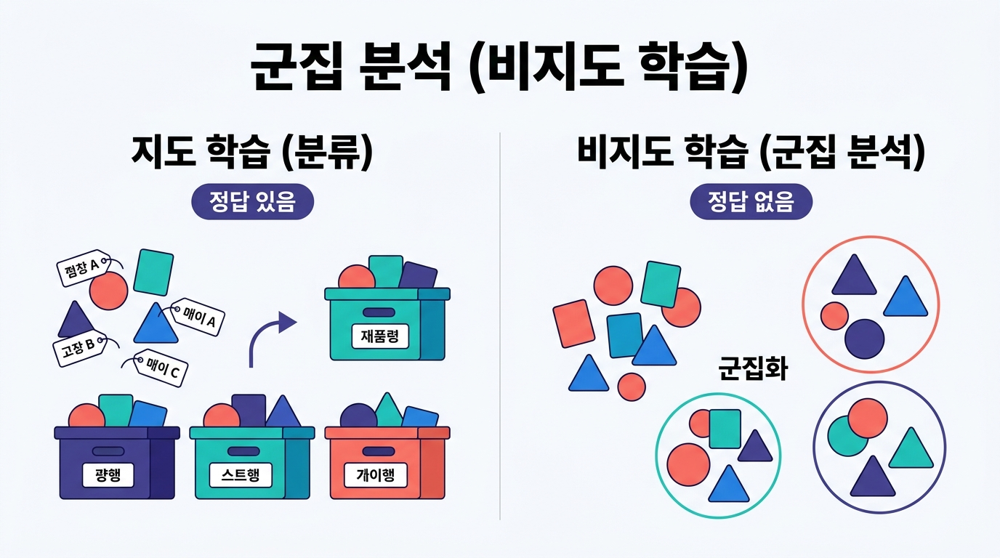
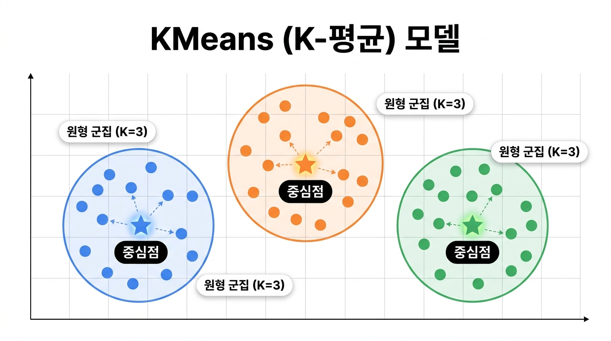
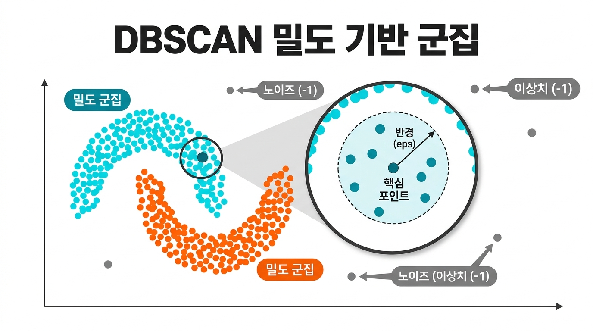

# 📊 군집 분석(Clustering) 완전 정복: KMeans & DBSCAN

> **이 문서는 `01_KMeans_DBSCAN.ipynb` 실습 노트를 바탕으로, 핵심 개념과 전체 파이썬 코드, 실행 결과, 직관적인 한글 인포그래픽 이미지, 그리고 머리에 쏙 들어오는 '찰떡 비유'를 더해 재구성한 마크다운 가이드입니다.**

---

## 1. 군집(Clustering) 분석이란?



### 💡 한눈에 이해하는 찰떡 비유: **"이름표 없는 옷장 정리하기"**
* **지도 학습(분류/회귀)**이 옷에 붙어있는 '상의', '하의', '외투'라는 **정답(이름표)을 보고 정리**하는 것이라면,
* **비지도 학습(군집 분석)**은 이름표가 하나도 없는 산더미 같은 옷들을 펼쳐놓고, **비슷한 색깔, 재질, 모양(패턴)끼리 묶어서 스스로 서랍(군집, Cluster)을 나누는 작업**입니다!

### 📌 핵심 개념 정리
* **비지도 학습 (Unsupervised Learning)**: 정답(Target / 종속변수) 데이터 없이, 오직 특징(독립변수) 데이터만 가지고 분류하는 방법입니다.
* **데이터 유형**: 정답 라벨이 정제되지 않은 데이터 패턴을 분석합니다.
* **군집(Cluster)**: 패턴이나 성질이 유사한 데이터들끼리 묶어놓은 하나의 그룹 단위입니다.
* **대표적인 모델**: `KMeans(K-평균)` 모델, `DBSCAN` 모델
* **대표적인 평가 지표**: `Silhouette Score(실루엣 계수)`, `Adjusted Rand Score(ARI)`

---

## 2. KMeans (K-평균) 모델의 이해



### 💡 한눈에 이해하는 찰떡 비유: **"운동장에 K개의 깃발(중심점) 꽂고 모이기"**
1. 선생님(분석가)이 운동장에 있는 학생들에게 **"총 3개(`K=3`)의 조로 나눌 거야!"**라고 미리 개수를 정해줍니다.
2. 운동장 아무 데나 **깃발(중심점, Centroid) 3개**를 꽂습니다.
3. 학생(데이터)들은 각자 **자신에게 가장 가까운 깃발**로 달려가 모입니다.
4. 학생들이 다 모이면, 각 조의 **정중앙 위치로 깃발을 다시 옮깁니다(중심점 재계산)**.
5. 깃발을 옮겼더니 내 위치에서 다른 조 깃발이 더 가까워진 학생들은 조를 이동합니다.
6. **더 이상 깃발의 위치가 움직이지 않을 때까지** 이 과정을 반복하면 완벽한 그룹 나누기 완성!

### 📌 KMeans 핵심 특징
* **사전 설정 필수**: 묶고자 하는 군집의 개수(`K`, `n_clusters`)를 모델을 만들 때 미리 지정해야 합니다. (하이퍼파라미터 튜닝 대상)
* **원형(구형) 군집 형성**: 중심점으로부터의 '거리'를 기준으로 묶기 때문에 동그란 원형 형태로 그룹이 만들어집니다.
* **빠른 속도**: 계산 방식이 직관적이어서 대규모 데이터에도 비교적 빠르고 효율적으로 동작합니다.

---

## 3. 실습 환경 설정 및 라이브러리 불러오기

데이터 조작, 시각화, 전처리, 그리고 군집 분석 및 평가에 필요한 라이브러리를 한 번에 불러옵니다.

```python
# 데이터 조작을 위한 라이브러리
import pandas as pd

# 기본 및 통계적 시각화 라이브러리
import matplotlib.pyplot as plt 
import seaborn as sns 

# 시각화 기본 설정 (그래프 크기, 한글 폰트, 마이너스 기호 깨짐 방지)
plt.rcParams["figure.figsize"] = (12, 5)
plt.rcParams["font.family"] = "Malgun Gothic"
plt.rcParams["axes.unicode_minus"] = False 

# 데이터 전처리 및 분리 라이브러리
from sklearn.model_selection import train_test_split, GridSearchCV
from sklearn.preprocessing import StandardScaler

# 군집(Clustering) 모델
from sklearn.cluster import KMeans, DBSCAN

# 주성분 분석 (차원 축소 시각화용)
from sklearn.decomposition import PCA

# 평가 지표 (지도학습 분류 평가 & 비지도학습 군집 평가)
from sklearn.metrics import accuracy_score, confusion_matrix
from sklearn.metrics import silhouette_score, adjusted_rand_score
```

---

## 4. [실습 1] 와인 데이터를 활용한 KMeans 군집화 및 튜닝

첫 번째 실습에서는 레드 와인(`0`)과 화이트 와인(`1`) 데이터가 담긴 `08_wine.csv`를 사용해 KMeans 모델을 학습시키고, 실제 와인 종류와 얼마나 비슷하게 묶어내는지 확인합니다.

### 4-1. 데이터 읽어 들이기 및 탐색
```python
file_path = "./data/08_wine.csv"
data = pd.read_csv(file_path)

data.info()
display(data.describe())
data.head(1)
```
* **데이터 구조**: 총 6,497개의 행과 4개의 컬럼(`alcohol`, `sugar`, `pH`, `class`)으로 구성되어 있으며 결측치(Null)가 없는 깨끗한 실수형(`float64`) 데이터입니다.
* `alcohol`(알코올 도수), `sugar`(당도), `pH`(산도)는 **독립변수(X)**로 사용하고, `class`(와인 종류: 0 또는 1)는 평가 비교를 위한 **종속변수(y)**로 분리합니다.

### 4-2. 독립변수 / 종속변수 분리 및 스케일링(표준화)

> **💡 왜 스케일링(`StandardScaler`)을 해야 할까요? — "단위(체급) 통일하기"**  
> 당도(`sugar`)는 최대 65.8까지 변하는데, 산도(`pH`)는 2.7~4.0 사이에서만 움직입니다. KMeans는 **'거리'**를 재서 군집을 나누기 때문에, 숫자가 큰 '당도'가 거리 계산을 독차지해버립니다(마치 키 170cm와 시력 1.5를 그냥 더해서 비교하는 격!). 따라서 모든 변수의 평균을 0, 표준편차를 1로 맞춰주는 **체급 맞추기(표준화)**가 필수입니다.

```python
# 독립변수(X)와 종속변수(y) 분리
X = data.iloc[:, :-1].to_numpy()
y = data["class"].to_numpy()

# StandardScaler를 이용한 표준화 처리
ss = StandardScaler()
X_scaler = ss.fit_transform(X)

# 훈련 데이터 : 테스트 데이터 = 8 : 2 분리
X_train, X_test, y_train, y_test = train_test_split(
    X_scaler, y, test_size=0.2, stratify=y, random_state=42
)
print(X_train.shape, y_train.shape) # (5197, 3) (5197,)
print(X_test.shape, y_test.shape)   # (1300, 3) (1300,)
```

### 4-3. KMeans 하이퍼파라미터 튜닝 (`GridSearchCV`)

* **`n_clusters`**: 묶을 군집의 개수 (와인 종류가 2개이므로 `2`로 설정, 모를 경우 보통 2부터 시작)
* **`n_init`**: 초기 중심점을 서로 다르게 찍어서 시도해 보는 횟수 (중심점 이동 시도 횟수)
* **`max_iter`**: 한 번의 시도 안에서 중심점을 재계산하며 이동하는 최대 반복 횟수
* **`tol`**: 중심점 이동 변화량이 이 값보다 작아지면 "수렴했다!"고 보고 일찍 훈련을 종료하는 기준값

```python
param_grid = {
    "n_init": [10, 30, 50],
    "max_iter": [10, 30, 50],
    "tol": [0.0001, 0.001, 0.01, 1]
}

cv = 5
scoring = "accuracy"
n_cluster = 2

# 기본 KMeans 모델 생성 및 GridSearchCV 설정
kmeans = KMeans(n_clusters=n_cluster, random_state=42)
grid_search = GridSearchCV(
    estimator=kmeans, 
    param_grid=param_grid, 
    scoring=scoring,         
    cv=cv                            
)

# 튜닝 클래스를 이용해 fit()할 때는 평가 기준(accuracy) 계산을 위해 X_train, y_train을 함께 넣습니다.
grid_search.fit(X_train, y_train)

# 최적의 모델 추출
best_model = grid_search.best_estimator_
print(best_model)
# 결과: KMeans(max_iter=10, n_clusters=2, n_init=50, random_state=42, tol=0.01)
```

### 4-4. 테스트 데이터 예측 및 산점행렬도(`pairplot`) 시각화
```python
test_pred = best_model.predict(X_test)

# 정확도 및 오차행렬 확인
test_acc = accuracy_score(y_test, test_pred)
test_cm = confusion_matrix(y_test, test_pred)

print(f"테스트 정확도 : {test_acc:.8f}") # 약 0.44538462
print("오차행렬 :\n", test_cm)

# 오차행렬 히트맵 시각화
sns.heatmap(test_cm, annot=True, fmt="d", cmap="Blues")
plt.show()

# 산점행렬도(Pairplot)를 위한 데이터프레임 가공
data_view = {
    "alcohol": X_test[:, 0],
    "sugar": X_test[:, 1],
    "pH": X_test[:, 2],
    "class": y_test,
    "cluster": test_pred
}
test_data = pd.DataFrame(data=data_view)

# cluster 결과를 색상(hue) 기준으로 분포 확인
sns.pairplot(test_data, hue="cluster")
plt.show()
```
* **📊 결과 해석**: 산점행렬도(`pairplot`)에서 군집이 잘 분리되었다면 색깔별로 영역이 뚜렷하게 나뉘어 보입니다. 반면 색이 많이 겹치거나 섞여 있다면 해당 변수들만으로는 경계가 모호하여 군집 분리가 완벽히 되지 않았음을 의미합니다.

---

## 5. [실습 2] IRIS(붓꽃) 데이터로 KMeans & PCA 시각화

두 번째 실습에서는 4개의 특성(꽃받침 길이/너비, 꽃잎 길이/너비)을 가진 붓꽃(Iris) 데이터를 3개의 군집으로 나누고, 이를 2차원 평면에 그려서 눈으로 확인합니다.

### 5-1. 데이터 로드 및 KMeans 학습
```python
from sklearn.datasets import load_iris

iris = load_iris()
X = iris.data
y = iris.target

# KMeans 모델 생성 (군집 3개, 중심점 초기화 10회)
Kmeans_model = KMeans(
    n_clusters=3,
    n_init=10,
    random_state=42
)

# 비지도 학습이므로 독립변수(X)만 사용하여 훈련!
Kmeans_model.fit(X)

# 군집 예측 결과 확인
kmeans_labels = Kmeans_model.predict(X)
print("예측 군집 번호:", kmeans_labels)
print("실제 정답 번호:", y)
```

> **⚠️ 주의! 군집 번호(Label)는 실제 정답 번호와 순서가 무관합니다!**  
> * 모델이 붙인 `0`, `1`, `2`라는 번호는 **임의로 붙인 조 이름(A조, B조, C조)**일 뿐입니다.
> * 출력 결과를 보면 실제 정답 `0`번 품종이 군집 `1`번으로, 실제 정답 `1`번 품종이 군집 `0`번으로 깔끔하게 모인 것을 볼 수 있습니다. 번호 숫자가 다르다고 틀린 것이 아니라, **같은 품종끼리 한 방에 잘 모였는지**가 핵심입니다!

### 5-2. 주성분 분석(PCA)을 통한 차원 축소 및 산점도 시각화

> **💡 주성분 분석(PCA)이란? — "입체 조각상을 가장 잘 보여주는 각도에서 찍은 2D 사진"**  
> 붓꽃 데이터는 특성이 4개(4차원)라서 종이 화면(2차원: X축, Y축)에 바로 점을 찍을 수가 없습니다.  
> **PCA(차원 축소)**는 데이터의 분산을 가장 잘 설명하는 **핵심 특징(엑기스) 2개만 뽑아내어 4차원 데이터를 2차원(X축, Y축) 평면 그림자 사진으로 압축**해 주는 기법입니다!

```python
# 2차원으로 차원 축소 변환기 생성 및 변환
pca = PCA(n_components=2)
X_pca = pca.fit_transform(X)

# 산점도(Scatter) 그리기
plt.title("KMeans IRIS")
plt.scatter(X_pca[:, 0], X_pca[:, 1], c=kmeans_labels)
plt.show()
```
* **📊 시각화 해석 방법**: 산점도에서 **군집 간의 거리가 멀고 뭉쳐 있을수록** 군집화가 잘 된 것이며, **군집끼리 붙어 있거나 겹쳐 있으면** 간섭이 있어 분리가 덜 된 것으로 해석합니다.

---

## 6. 군집 분석 평가 지표 (Evaluation Metrics)

군집이 얼마나 잘 되었는지 숫자로 채점하는 두 가지 대표적인 방법입니다.

| 평가 지표 | 정답(y) 필요 여부 | 점수 범위 | 해석 기준 및 비유 |
| :--- | :---: | :---: | :--- |
| **`silhouette_score`**<br>(실루엣 계수) | ❌ 불필요<br>(독립변수 + 예측결과) | `-1` ~ `1` | **"우리 반끼리는 똘똘 뭉치고(응집도), 옆 반과는 멀찍이 떨어져 있는가(분리도)?"**<br>• **`1`에 가까울수록**: 경계가 뚜렷하고 아주 잘 분리된 군집<br>• **`0`에 가까울수록**: 군집끼리 겹치거나 경계가 모호함<br>• **`-1`에 가까울수록**: 데이터가 엉뚱한 군집에 잘못 들어감 |
| **`adjusted_rand_score`**<br>(ARI 점수) | ⭕ **필수**<br>(실제정답 + 예측결과) | `-1` ~ `1` | **"모델이 나눈 그룹이 실제 정답 족보와 얼마나 똑같은가?"**<br>(군집 번호가 달라도 구성원이 같으면 높은 점수 부여)<br>• **`1`**: 실제 정답과 100% 완벽히 일치<br>• **`0`**: 무작위로 찍은 것과 다름없이 불일치가 많음<br>• **음수**: 정답과 오히려 반대로 묶임 |

```python
# 1. 실루엣 평가 (독립변수 X, 예측결과 kmeans_labels)
s_score = silhouette_score(X, kmeans_labels)

# 2. ARI 평가 (실제종속변수 y, 예측결과 kmeans_labels)
a_score = adjusted_rand_score(y, kmeans_labels)

print("KMeans 실루엣 점수:", s_score) # 약 0.5528
print("KMeans ARI 점수:", a_score)    # 약 0.7302
```

---

## 7. [실습 3] DBSCAN 모델을 활용한 밀도 기반 군집화



### 💡 한눈에 이해하는 찰떡 비유: **"밤하늘의 반딧불이 무리(별자리) 찾기 & 외톨이 걸러내기"**
* KMeans는 무조건 모든 데이터를 가장 가까운 깃발로 끌고 가지만, **DBSCAN**은 **데이터가 빽빽하게 모여 있는 정도(밀도, Density)**를 봅니다!
* 내 팔 길이 반경(`eps`) 안에 친구들이 최소 5명(`min_samples=5`) 이상 모여 있으면 **"여긴 인싸 무리(핵심 포인트)다!"** 하고 손잡고 하나의 군집으로 계속 뻗어나갑니다.
* 반대로 주변 반경에 친구가 별로 없이 동떨어진 데이터는 억지로 군집에 끼워 넣지 않고 **"얘는 외톨이(노이즈/이상치, `-1`)!"**라고 깔끔하게 분류해 냅니다.

### 📌 DBSCAN 핵심 특징 및 파라미터
* **사전 군집 개수 설정 불필요**: 데이터 밀도에 따라 군집 개수가 자동으로 결정됩니다.
* **비원형(기하학적) 군집 가능**: 도넛 모양, 초승달 모양 등 길쭉하거나 복잡한 형태의 군집도 잘 찾아냅니다.
* **노이즈(이상치) 자동 검출**: 어디에도 속하지 못하는 외곽 데이터를 **`-1`**로 분류하여 이상치를 걸러냅니다.
* **주요 파라미터**:
  * `eps (epsilon)`: 이웃으로 간주할 최대 거리 반경
  * `min_samples`: 하나의 군집(핵심 포인트)을 형성하기 위해 `eps` 반경 내에 있어야 하는 최소 데이터 수

### 7-1. DBSCAN 모델 생성 및 학습 (`fit_predict`)
```python
# 반경(eps)=0.5, 최소 샘플 수(min_samples)=5로 모델 생성
dbscan = DBSCAN(eps=0.5, min_samples=5)

# DBSCAN은 훈련과 동시에 예측 결과를 반환하는 fit_predict()를 주로 사용합니다.
clusters = dbscan.fit_predict(X)
print(clusters)
```
* **결과 확인**: 배열 안에 `0`, `1` (2개의 군집)과 `-1` (군집에 속하지 못한 노이즈/이상치)이 출력됩니다.

### 7-2. 노이즈(`-1`) 데이터 필터링 및 제거
군집의 품질을 높이고 깔끔한 분포를 보기 위해 `-1`로 판정된 이상치 데이터를 제거합니다.

```python
# clusters 값이 -1인 위치는 True, 정상 군집(0, 1)인 위치는 False인 불리언 마스크 생성
noise = (clusters == -1)

# 노이즈가 아닌(False) 정상 데이터만 추출
X_cleaned = X[noise == False]
clusters_cleaned = clusters[noise == False]

print("원본 데이터 크기:", X.shape)               # (150, 4)
print("노이즈 제거 후 크기:", X_cleaned.shape)     # (133, 4) -> 17개의 노이즈 제거됨!
```

### 7-3. 노이즈 제거 전/후 PCA 시각화 비교
```python
pca = PCA(n_components=2)
pca.fit(X)

# 노이즈 제거 전/후 데이터를 각각 2차원으로 변환
X_pca_org = pca.transform(X)
X_pca_cleaned = pca.transform(X_cleaned)

# 1) 노이즈 제거 전 산점도 (보라색 점 등 외곽 노이즈가 함께 표시됨)
plt.title("DBSCAN (노이즈 제거 전)")
plt.scatter(X_pca_org[:, 0], X_pca_org[:, 1], c=clusters)
plt.show()

# 2) 노이즈 제거 후 산점도 (깔끔하게 뭉친 2개의 군집만 표시됨)
plt.title("DBSCAN (노이즈 제거 후)")
plt.scatter(X_pca_cleaned[:, 0], X_pca_cleaned[:, 1], c=clusters_cleaned)
plt.show()
```

### 7-4. 노이즈 제거 전/후 군집 평가 비교
```python
# 1. 실루엣 점수(silhouette_score) 비교
sil_noise_ok = silhouette_score(X, clusters)
sil_noise_no = silhouette_score(X_cleaned, clusters_cleaned)
print("실루엣 점수 (제거 전 vs 제거 후):", sil_noise_ok, "->", sil_noise_no)
# 결과: 0.4860 -> 0.7354 (노이즈 제거 후 군집 응집도/분리도가 대폭 상승!)

# 2. ARI 점수(adjusted_rand_score) 비교
ari_noise_ok = adjusted_rand_score(y, clusters)
ari_noise_no = adjusted_rand_score(y[noise == False], clusters_cleaned)
print("ARI 점수 (제거 전 vs 제거 후):", ari_noise_ok, "->", ari_noise_no)
# 결과: 0.5206 -> 0.6073 (노이즈 제거 후 정답 일치도 역시 상승!)
```

---

## 8. 최종 요약 및 결론: 언제 어떤 모델을 쓸까?

| 비교 항목 | KMeans (K-평균) | DBSCAN (밀도 기반) |
| :--- | :--- | :--- |
| **군집 개수(`K`)** | **사전에 직접 지정해야 함** | **자동으로 결정됨** (지정 불필요) |
| **군집 형태** | 원형(구형) 클러스터에 강함 | 비원형, 기하학적/불규칙한 형태에 강함 |
| **이상치(Noise)** | 이상치까지 억지로 군집에 포함시킴 | 이상치를 **`-1`로 자동 분류 및 제거 가능** |
| **데이터 크기/속도** | 대용량 데이터에서도 **속도가 빠름** | 데이터가 너무 많으면 거리 계산에 시간이 걸림 |
| **IRIS 실습 결론** | 꽃의 품종이 3개라는 것을 알고 `n_clusters=3`을 주었을 때 **실제 3개 품종으로 꽤 정확하게 분류함** (`ARI: 0.73`) | 두 품종(Versicolor, Virginica)의 밀도가 서로 붙어 있어서 하나의 군집으로 합쳐버려 **2개의 군집으로만 분류됨** (단, 노이즈 제거 시 실루엣 점수는 `0.735`로 매우 우수) |
