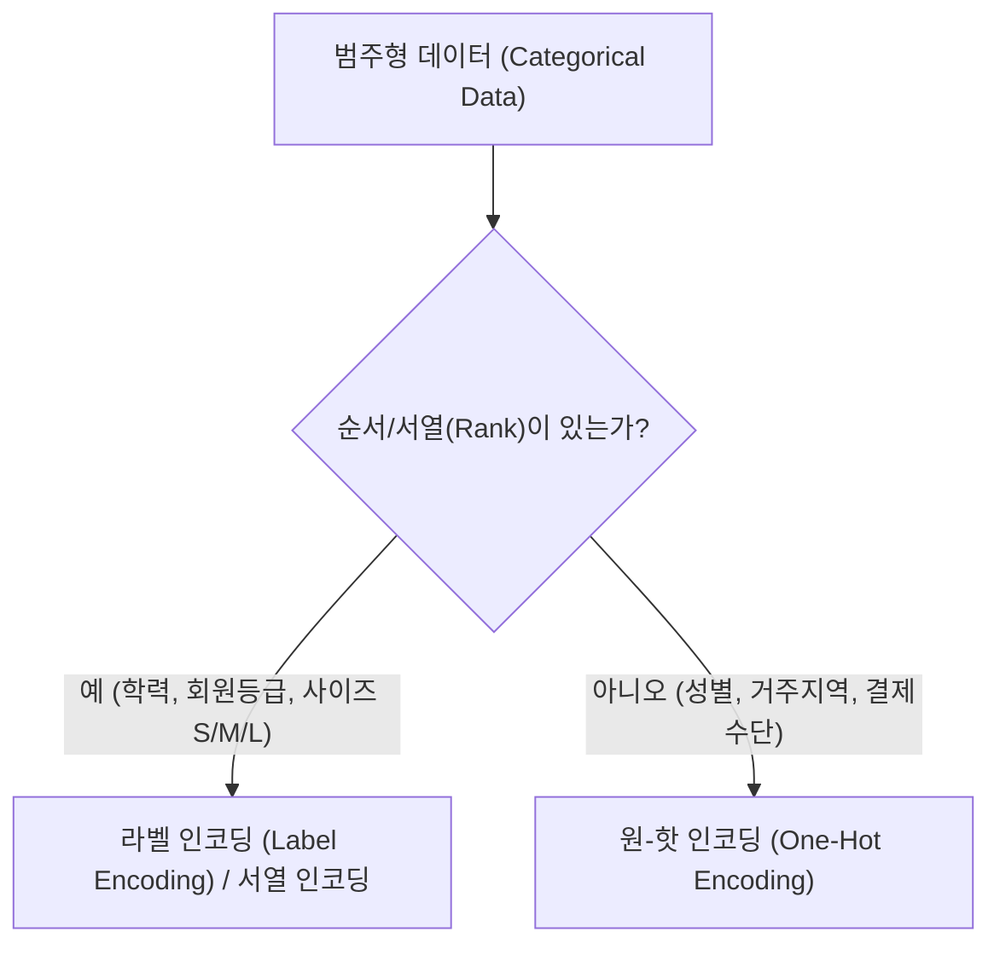

# 📊 [특성 공학(Feature Engineering) 심층 분석 종합 보고서]
> **대상 파일:** `3day_Feature_Engineering.ipynb` (Cell 00 ~ Cell 41 전수 분석)  
> **분석 기준 시점:** Chapter 1 ~ Chapter 4 완성본 (시각화, 상관분석, 인코딩, 스케일링)  
> **작성 목적:** 작성된 모든 코드의 행 단위 로직 해석, 수학적·통계적 배경 설명, 직관적 일상 비유 및 실무 활용 팁 집대성

---

## 📑 목차 (Table of Contents)

1. [총론: 특성 공학(Feature Engineering) 개요 및 파이프라인](#1-총론-특성-공학feature-engineering-개요-및-파이프라인)
   - 1.1 특성 공학이란 무엇인가?
   - 1.2 전체 8단계 로드맵 및 현재 진도율 현황
   - 1.3 사용 데이터셋(`01_03_clean_ecommerce_data_clean.csv`) 구조 분석
2. [Chapter 1: 단일 변수 분포 시각화 및 특성 파악](#2-chapter-1-단일-변수-분포-시각화-및-특성-파악)
   - 2.1 찰떡 비유: "기본 신체 계측과 체질 진단"
   - 2.2 라이브러리 환경 설정 및 한글 깨짐 방지 (Cell 02)
   - 2.3 데이터 로드 및 결측치/타입 점검 (Cell 04)
   - 2.4 수치형 데이터(Age, Tenure) 다중 서브플롯 히스토그램 & KDE (Cell 06)
   - 2.5 범주형 데이터(Gender) countplot을 통한 데이터 편향(Bias) 점검 (Cell 08)
3. [Chapter 2: 다변량 상관관계 분석 및 통계적 유의성(p-value) 검증](#3-chapter-2-다변량-상관관계-분석-및-통계적-유의성p-value-검증)
   - 3.1 찰떡 비유: "둘 사이의 끈끈한 케미(상관계수)와 법정 증거(p-value)"
   - 3.2 수학적·통계적 원리: 피어슨(선형) vs 스피어만(순위) 상관계수
   - 3.3 수치형 변수 필터링 및 피어슨 상관행렬 도출 (Cell 11, 13)
   - 3.4 히트맵(Heatmap)을 통한 다변량 시각화 (Cell 15)
   - 3.5 Tenure vs TotalCharges 피어슨 가설 검정 (Cell 17)
   - 3.6 ReviewScore vs MonthlyCharges 스피어만 순위 가설 검정 (Cell 19)
   - 3.7 타겟(Churn)과 피처 간 자동 가설 검정 3가지 구현 패턴 비교 분석 (Cell 20, 21, 22)
4. [Chapter 3: 범주형 데이터 인코딩 (Label & One-Hot Encoding)](#4-chapter-3-범주형-데이터-인코딩-label--one-hot-encoding)
   - 4.1 찰떡 비유: "AI를 위한 통역기: 학생 번호표(Label) vs OMR 마킹(One-Hot)"
   - 4.2 인코딩 방식별 핵심 원리와 서열 왜곡 문제
   - 4.3 원본 보존을 위한 DataFrame 복제(`copy()`)와 LabelEncoder (Cell 25, 26)
   - 4.4 Gender 변수 라벨 인코딩 (`fit_transform` & `classes_`) (Cell 28, 29)
   - 4.5 가상 Membership 컬럼 생성 및 판다스 `get_dummies` 원-핫 인코딩 (Cell 31, 32)
5. [Chapter 4: 수치형 데이터 스케일링 (Standard, MinMax, Robust)](#5-chapter-4-수치형-데이터-스케일링-standard-minmax-robust)
   - 5.1 찰떡 비유: "수능 표준점수(Standard) vs 볼륨 게이지(MinMax) vs 피겨 심사(Robust)"
   - 5.2 3대 스케일러의 수학 공식, 이상치 민감도, 현업 채택 비율
   - 5.3 스케일링 대상 컬럼 추출 (Cell 34, 35, 36)
   - 5.4 3대 스케일러 개별 적용 실습 (Cell 37, 38, 39)
   - 5.5 자동화 반복문 코드 비교 리뷰 (Cell 40 vs Cell 41 심층 리팩토링)
   - 5.6 실무 주의사항: 데이터 누수(Data Leakage) 방지 원칙
6. [종합 요약 및 차기 단계(Chapter 5~8) 로드맵](#6-종합-요약-및-차기-단계chapter-58-로드맵)

---

## 1. 총론: 특성 공학(Feature Engineering) 개요 및 파이프라인

### 1.1 특성 공학이란 무엇인가?
> [!NOTE]
> **특성 공학(Feature Engineering)**은 원시 데이터(Raw Data)를 머신러닝 알고리즘이 패턴을 가장 쉽고 정확하게 학습할 수 있는 형태의 **'최적화된 특성(Feature)'**으로 재가공·변환·창조하는 일련의 과정입니다.
> 
> *“쓰레기를 넣으면 쓰레기가 나온다(Garbage In, Garbage Out)”*는 머신러닝의 격언처럼, 아무리 뛰어난 딥러닝/최신 알고리즘을 쓰더라도 피처의 품질이 낮으면 모델의 예측 성능은 처참해집니다.


### 1.2 전체 8단계 로드맵 및 현재 진도율 현황
노트북 `3day_Feature_Engineering.ipynb`는 실무 머신러닝 파이프라인의 표준 8단계를 따르고 있으며, 현재 **4단계(수치형 스케일링)**까지 성공적으로 구축되었습니다.

| 단계 | 소주제 | 진행 상태 | 핵심 내용 |
|:---:|:---|:---:|:---|
| **0단계** | 용어 정의 | ✅ 완료 | 컬럼 = 항목 = 특성 = 피처(Feature) 동의어 정립 |
| **1단계** | 단일 변수 시각화 및 특성 파악 | ✅ **완료 (Cell 02~08)** | Age, Tenure 히스토그램, Gender 편향 점검 |
| **2단계** | 다변량 상관관계 분석 & p-value 검증 | ✅ **완료 (Cell 09~22)** | 피어슨/스피어만 상관계수, Heatmap, 가설검정 자동화 |
| **3단계** | 범주형 데이터 인코딩 | ✅ **완료 (Cell 23~32)** | LabelEncoder(성별), get_dummies 원핫(멤버십) |
| **4단계** | 수치형 데이터 스케일링 | ✅ **완료 (Cell 33~41)** | StandardScaler, MinMaxScaler, RobustScaler 비교 및 자동화 |
| **5단계** | 비즈니스 로직 파생변수 생성 | ⏳ 예정 | 결제비율, 고객센터 문의율 등 새로운 지표 창출 |
| **6단계** | 타겟(Churn) 클래스 불균형 확인 | ⏳ 예정 | 유지 고객(0) vs 이탈 고객(1) 비율 진단 |
| **7단계** | SMOTE 기반 오버샘플링 | ⏳ 예정 | KNN 알고리즘 기반 가상 데이터 합성으로 1:1 보정 |
| **8단계** | 데이터 분할 (Train/Val/Test = 6:2:2) | ⏳ 예정 | 모델 과적합 방지를 위한 3분할 데이터셋 구축 |

### 1.3 사용 데이터셋 구조 분석 (`01_03_clean_ecommerce_data_clean.csv`)
- **데이터 규모:** 4,982개 행(Rows), 9개 열(Columns), 결측치(Null) 0건
- **컬럼 구성:**
  - `CustomerID` (int64): 고객 식별 고유번호 (학습 제외 대상)
  - `Age` (int64): 고객 나이 (연속형/정수형)
  - `Gender` (object): 성별 (범주형 문자열: Male, Female)
  - `Tenure` (int64): 서비스 이용 개월 수 (연속형/정수형)
  - `MonthlyCharges` (float64): 월 결제 금액 (연속형/실수형)
  - `TotalCharges` (float64): 누적 총 결제 금액 (연속형/실수형)
  - `SupportCalls` (int64): 고객센터 문의 횟수 (이산형/정수형)
  - `ReviewScore` (float64): 평점 리뷰 점수 (연속형/실수형)
  - `Churn` (int64): 고객 이탈 여부 (**Target / 정답 레이블**, 0: 잔존, 1: 이탈)

---

## 2. Chapter 1: 단일 변수 분포 시각화 및 특성 파악

### 2.1 찰떡 비유 💡
> **"종합병원 건강검진 전, 체온계와 문진표로 환자의 기본 체질부터 훑어보기"**  
> 의사가 환자를 수술대에 올리기 전, 환자의 키, 몸무게, 혈압(수치형)과 혈액형(범주형)을 먼저 재어 특이사항이 없는지 차트로 확인하는 것과 같습니다. 노인 환자가 유독 많은지, 남녀 비율이 한쪽으로 쏠려 있지 않은지(데이터 편향)를 먼저 눈으로 확인해야 올바른 처방을 내릴 수 있습니다.

---

### 2.2 라이브러리 환경 설정 및 한글 깨짐 방지 (Cell 02)
```python
# 데이터 조작 라이브러리
import pandas as pd

# 기본 및 통계적 시각화 라이브러리
import matplotlib.pyplot as plt
import seaborn as sns

# 그래프 기본 크기 설정 (가로 12인치, 세로 5인치)
plt.rcParams["figure.figsize"] = (12, 5)

# 한글 폰트 설정 (Windows 기본 맑은 고딕)
plt.rcParams['font.family'] = 'Malgun Gothic'

# 마이너스(-) 기호 깨짐 방지
plt.rcParams['axes.unicode_minus'] = False
```

#### 🔍 코드 및 로직 심층 분석
1. **`plt.rcParams["figure.figsize"] = (12, 5)`**:  
   - 노트북 내에서 생성되는 모든 시각화 캔버스의 기본 크기를 12:5 비율로 통일합니다. 와이드 모니터에서 서브플롯 2개를 나란히 보기에 가장 안정적인 황금 비율입니다.
2. **`plt.rcParams['font.family'] = 'Malgun Gothic'`**:  
   - Matplotlib의 기본 폰트(DejaVu Sans)는 한글 글리프(Glyph)가 없어 그래프에 한글 제목을 넣으면 네모 박스(`□□□`)로 깨져 출력됩니다. 이를 방지하기 위해 Windows 시스템에 내장된 `'Malgun Gothic'`을 글로벌 폰트로 강제 지정합니다.
3. **`plt.rcParams['axes.unicode_minus'] = False`**:  
   - 축(Axis)에 음수 값(`-1`, `-0.5` 등)이 표시될 때, 기본 설정에서는 유니코드 마이너스 문자를 렌더링하지 못해 특수문자 깨짐 오류가 발생합니다. `False`로 지정하면 표준 하이픈(`-`) 아스키코드로 정상 렌더링됩니다.

---

### 2.3 데이터셋 로드 및 결측치/타입 점검 (Cell 04)
```python
df = pd.read_csv("./dataset/01_03_clean_ecommerce_data_clean.csv")
df.info()
```
#### 🔍 코드 및 로직 심층 분석
- `pd.read_csv(...)`로 2일차에서 결측치와 이상치가 정제된 깨끗한 CSV 데이터를 메모리에 DataFrame으로 적재합니다.
- `df.info()`를 호출하여 총 4,982개 행 모두 `Non-Null Count`가 4982개임을 재확인하고, `Gender`만 유일하게 `object(문자열)` 타입이고 나머지는 `int64`, `float64` 수치형임을 파악합니다.

---

### 2.4 수치형 데이터(Age, Tenure) 다중 서브플롯 히스토그램 & KDE (Cell 06)
```python
# 하나의 도화지에 1행 2열 공간(서브플롯) 생성
fig, axes = plt.subplots(1, 2)

# 첫 번째 서브플롯: 고객 나이(Age) 히스토그램 + KDE 곡선
sns.histplot(df["Age"], bins=40, kde=True, ax=axes[0], color="skyblue")
axes[0].set_title("고객 나이(Age) 분포")

# 두 번째 서브플롯: 가입 기간(Tenure) 히스토그램 + KDE 곡선
sns.histplot(df["Tenure"], bins=24, kde=True, ax=axes[1], color='salmon')
axes[1].set_title("가입 기간(Tenure_월) 분포")

# 서브플롯 간 여백 겹침 자동 최적화
plt.tight_layout()
plt.show()
```
#### 🔍 코드 및 로직 심층 분석
1. **`fig, axes = plt.subplots(1, 2)`**:  
   - `fig`는 전체 도화지 객체, `axes`는 개별 플롯(축)을 담은 1차원 배열입니다. `axes[0]`은 왼쪽, `axes[1]`은 오른쪽 그래프 영역을 가리킵니다.
2. **`bins` 파라미터 (막대 구간 개수)**:  
   - `Age`(나이)는 사람의 수명이 약 18~70세에 걸쳐 넓게 퍼져 있으므로 `bins=40`으로 잘게 쪼개어 세밀한 분포를 보았습니다.
   - `Tenure`(가입 개월 수)는 1년~2년(12~24개월) 단위 주기를 고려하여 `bins=24`로 설정해 월별 계절성이나 분포를 한눈에 볼 수 있도록 설계했습니다.
3. **`kde=True` (Kernel Density Estimation, 커널 밀도 추정)**:  
   - 이산적인 막대그래프 위에 부드러운 확률 밀도 곡선을 덧그립니다. 데이터가 특정 연령대나 특정 개월 수에 봉우리(Bimodal/Multimodal)를 형성하는지 직관적으로 판단할 수 있습니다.
4. **`plt.tight_layout()`**:  
   - 여러 서브플롯을 배치할 때 축 레이블이나 제목이 서로 겹치는 현상을 방지하는 필수 정리 함수입니다.

---

### 2.5 범주형 데이터(Gender) countplot을 통한 데이터 편향(Bias) 점검 (Cell 08)
```python
plt.title("고객 성별(Gender) 분포")
sns.countplot(data=df, x="Gender", hue="Gender", palette="Set2", legend=True)
plt.show()
```
#### 🔍 코드 및 로직 심층 분석
1. **`sns.countplot`**:  
   - 범주형 데이터의 각 클래스별 등장 빈도(건수)를 계산하여 막대그래프로 나타냅니다.
2. **`hue="Gender"`와 `palette="Set2"`**:  
   - 범주별로 색상을 다르게 입혀 시각적 분별력을 높였습니다. (최신 Seaborn 경고를 피하기 위해 `hue` 지정 시 `legend=True`를 명시함).
3. **데이터 편향(Bias) 점검의 목적**:  
   - 남성과 여성의 데이터 수가 50:50에 가깝게 고르게 분포되어 있는지 확인합니다. 만약 한쪽 성별이 90% 이상이면 모델이 "모든 고객은 남성일 것이다"라고 성급한 일반화를 학습하는 **성별 편향(Gender Bias)**이 발생하기 때문입니다.

---

## 3. Chapter 2: 다변량 상관관계 분석 및 통계적 유의성(p-value) 검증

### 3.1 찰떡 비유 💡
> **"둘 사이의 끈끈한 케미(상관계수)와 우연이 아님을 밝히는 과학수사 증거(p-value)"**  
> - **상관계수(Correlation)**: 철수와 영희가 얼마나 붙어 다니는지 측정하는 '단짝 지수'(-1 ~ +1)입니다. 철수가 밥을 많이 먹을 때 영희도 밥을 많이 먹으면 양의 상관관계(+1), 철수가 웃을 때 영희가 울면 음의 상관관계(-1)입니다.  
> - **p-value(유의확률)**: "이 둘이 같이 붙어 다닌 게 그냥 길 가다 마주친 **우연의 일치(우연)**인가, 아니면 진짜 **필연적인 인연(유의미)**인가?"를 판별하는 과학적 기준입니다. 우연히 마주칠 확률이 5%(0.05)보다 낮다면, 법원은 "이건 우연이 아니라 명백한 유의미한 관계다!"라고 판결합니다.

---

### 3.2 수학적·통계적 원리: 피어슨 vs 스피어만

| 구분 | **피어슨 상관계수 ($r$)** | **스피어만 순위 상관계수 ($\rho$)** |
|:---|:---|:---|
| **기본 가정** | 두 변수 모두 **연속형 정규분포**, **선형성(직선 관계)** 가정 | 데이터 분포 무관, **비선형 단조 관계(순위/서열)** |
| **수학 공식** | $r = \frac{\sum (X-\bar{X})(Y-\bar{Y})}{\sqrt{\sum(X-\bar{X})^2 \sum(Y-\bar{Y})^2}}$ | $\rho = 1 - \frac{6 \sum d_i^2}{n(n^2 - 1)}$ ($d_i$: 두 변수의 순위 차이) |
| **이상치 민감도** | 극단적인 이상치(Outlier)에 **매우 민감**하게 왜곡됨 | 값의 크기가 아닌 '등수(순위)'를 쓰므로 이상치에 **매우 강건(Robust)** |
| **적용 사례** | 키 vs 몸무게, 가입기간 vs 누적결제액 | 영화 별점(1~5점), 고객 만족도 설문, 석차 순위 |

---

### 3.3 수치형 변수 필터링 및 피어슨 상관행렬 도출 (Cell 11, 13)
```python
from scipy import stats

# 문자열(Gender 등)을 제외하고 오직 수치형(number) 컬럼만 추출
number_df = df.select_dtypes(include=["number"])

# 피어슨 상관행렬표 산출
corr_matrix = number_df.corr(method="pearson")
corr_matrix
```
#### 🔍 코드 및 로직 심층 분석
- 문자열 컬럼(`Gender`)이 포함된 상태에서 상관계수를 계산하면 판다스 최신 버전에서 `TypeError`가 발생합니다. 따라서 `df.select_dtypes(include=["number"])`를 통해 수치형 컬럼만 스마트하게 분리 추출했습니다.
- `number_df.corr(method="pearson")`는 각 변수 쌍 간의 공분산을 표준편차의 곱으로 나눈 $r$ 값을 $N \times N$ 정방행렬로 반환합니다.

---

### 3.4 히트맵(Heatmap)을 통한 다변량 시각화 (Cell 15)
```python
plt.figure(figsize=(10, 8))
plt.title('수치형 특성 간 피어슨 상관계수 히트맵 시각화')
sns.heatmap(corr_matrix, annot=True, fmt=".2f", cmap="coolwarm", vmin=-1, vmax=1)
plt.show()
```
#### 🔍 코드 및 로직 심층 분석
- `annot=True`: 각 히트맵 타일 중앙에 실제 상관계수 수치를 표시합니다.
- `fmt=".2f"`: 소수점 둘째 자리까지 반올림하여 가독성을 높입니다.
- `cmap="coolwarm"`: -1(강한 음의 상관)은 차가운 파란색(Cool), 0은 흰색, +1(강한 양의 상관)은 뜨거운 붉은색(Warm)으로 시각화합니다.
- `vmin=-1, vmax=1`: 컬러바의 스펙트럼 한계값을 -1과 +1로 고정하여 색상 왜곡을 방지합니다.

---

### 3.5 Tenure vs TotalCharges 피어슨 가설 검정 (Cell 17)
```python
pearson_coef, p_value_pearson = stats.pearsonr(df["Tenure"], df["TotalCharges"])
print(f"가입기간 vs 총결제액 상관관계 계수 = {pearson_coef: .3f} / p-value = {p_value_pearson}")

if p_value_pearson < 0.05:
    print("가입기간(Tenure)과 총결제액(TotalCharges) 간의 관계는 유의미 합니다")
else:
    print("가입기간(Tenure)과 총결제액(TotalCharges) 간의 관계는 유의미 하지 않습니다")
```
#### 🔍 코드 및 로직 심층 분석
- **비즈니스 도메인 상식**: 고객이 오래 가입해 있을수록(`Tenure` $\uparrow$) 매월 요금이 누적되어 총 결제액(`TotalCharges` $\uparrow$)도 필연적으로 증가합니다.
- **결과 검증**: 실제로 상관계수 $r \approx 0.8 \sim 0.9$ 수준의 매우 강력한 양의 상관관계가 나타나며, $p\text{-value} \ll 0.05$ (거의 $0$에 수렴)이므로 **"가입기간과 총결제액은 통계적으로 완벽히 유의미한 관계"**임을 수학적으로 입증했습니다.

---

### 3.6 ReviewScore vs MonthlyCharges 스피어만 순위 가설 검정 (Cell 19)
```python
spearman_coef, p_values_pearman = stats.spearmanr(df["ReviewScore"], df["MonthlyCharges"])
print(f"리뷰점수 vs 월결제액 상관관계 계수 = {spearman_coef: .3f} / p-value = {p_values_pearman}")

if p_values_pearman < 0.05:
    print("리뷰점수(ReviewScore)와 월결제액(MonthlyCharges) 간의 관계는 유의미 합니다")
else:
    print("리뷰점수(ReviewScore)와 월결제액(MonthlyCharges) 간의 관계는 유의미 하지 않습니다")
```
#### 🔍 코드 및 로직 심층 분석
- `ReviewScore`는 1점~5점 형태의 만족도 순위(서열) 데이터의 성격을 띠므로, 정규분포를 전제하는 피어슨보다 **스피어만 순위 상관분석(`stats.spearmanr`)**이 통계학적으로 훨씬 적합합니다.

---

### 3.7 타겟(Churn)과 피처 간 자동 가설 검정 3가지 구현 패턴 비교 분석 (Cell 20, 21, 22)

학생(사용자)은 노트북에서 Churn과 6개 변수 간의 가설 검정을 자동화하기 위해 3가지 방식으로 코드를 점진적으로 발전시켰습니다. 각 패턴의 장단점을 프로페셔널하게 비교합니다.

#### 📌 패턴 1: 이중 for문과 break 제어 (Cell 20)
```python
columns = ["Age", "Tenure", "MonthlyCharges", "TotalCharges", "SupportCalls", "ReviewScore"]
names = ["고객 나이", "가입 기간 월단위", "월 평균 결제액", "총 결제액", "고객센터 문의 횟수", "리뷰 평균 점수"]

for n in names:
    for i in columns:
        pearson_coef, p_value_pearson = stats.pearsonr(df["Churn"], df[i])
        # ... 출력 및 if문 ...
        if n == "리뷰 평균 점수":
            break
```
> [!WARNING]
> **패턴 1 코드 리뷰:**  
> `names`와 `columns`를 이중 for문으로 돌리면 $6 \times 6 = 36$번의 연산이 수행되려다 마지막에 임의로 `break`를 걸어 멈추는 비효율적인 구조입니다. 두 리스트의 인덱스를 1:1로 묶으려면 `zip(names, columns)`을 사용하는 것이 표준적인 파이썬 스타일입니다.

#### 📌 패턴 2: 딕셔너리(Key-Value) 매핑 순회 (Cell 21) ⭐ 우수 코드
```python
columns = {
    "Age": "고객 나이", "Tenure": "가입 기간 월단위", "MonthlyCharges": "월 평균 결제액",
    "TotalCharges": "총 결제액", "SupportCalls": "고객센터 문의횟수", "ReviewScore": "리뷰 평균 점수"
}

for k, v in columns.items():
    pearson_coef, p_value_pearson = stats.pearsonr(df["Churn"], df[k])
    print(f"이탈여부(Churn) vs {v}({k}) \n상관관계 계수 = {pearson_coef: .3f} / p-value = {p_value_pearson}")
    if p_value_pearson < 0.05:
        print(f"이탈여부(Churn)과 {v}({k}) 간의 관계는 유의미 합니다.\n")
    else:
        print(f"이탈여부(Churn)과 {v}({k}) 간의 관계는 유의미 하지 않습니다. \n")
```
> [!TIP]
> **패턴 2 코드 리뷰:**  
> 영문 컬럼명(`k`)과 친절한 한글 설명(`v`)을 딕셔너리로 묶어 `for k, v in columns.items():`로 단일 루프를 돌린 아주 훌륭하고 직관적인 코드입니다!

#### 📌 패턴 3: 판다스 drop() 함수를 활용한 컬럼 슬라이싱 (Cell 22) 🚀 파이썬틱한 코드
```python
# 식별자(CustomerID), 범주형(Gender), 타겟 본인(Churn)만 제외하고 나머지 수치 컬럼 일괄 추출
cols = df.columns.drop(['CustomerID', 'Gender', 'Churn'])

for col in cols:
    pearson_coef, p_value_pearson = stats.pearsonr(df["Churn"], df[col])
    print(f"Churn vs {col} \n상관관계 계수 = {pearson_coef: .3f} / p-value = {p_value_pearson}")
    if p_value_pearson < 0.05:
        print(f"Churn과 {col} 간의 관계는 유의미 합니다 \n")
    else:
        print(f"Churn과 {col} 간의 관계는 유의미 하지 않습니다 \n")
```
> [!TIP]
> **패턴 3 코드 리뷰:**  
> 컬럼 목록을 하드코딩하지 않고, `df.columns.drop(...)`을 통해 분석 대상이 아닌 열만 쏙 빼내는 실무 현업에서 가장 애용되는 간결하고 세련된 판다스 활용법입니다.

---

## 4. Chapter 3: 범주형 데이터 인코딩 (Label & One-Hot Encoding)

### 4.1 찰떡 비유 💡
> **"외국인(AI)을 위한 번역기: 학생 번호표(Label) vs OMR 카드 마킹(One-Hot)"**  
> AI는 태생이 수학 계산기라 한글 텍스트("남성", "여성", "골드회원")를 입력하면 사칙연산을 못 해 뇌정지가 옵니다. 따라서 문자를 반드시 '숫자'로 번역해 주어야 합니다.  
> - **라벨 인코딩(Label Encoding)**: 학생들에게 `1번, 2번, 3번...` 번호표를 나눠주는 방식입니다. 줄(컬럼) 하나로 끝나서 간편하지만, AI가 *"3번 학생이 1번 학생보다 3배 더 크고 우월하네?"*라고 엉뚱한 **서열 오해(수학적 왜곡)**를 살 수 있습니다.  
> - **원-핫 인코딩(One-Hot Encoding)**: 객관식 시험 OMR 카드의 동그라미 마킹과 같습니다. [Basic, Silver, Gold] 3칸을 만들어 놓고, 본인 등급에만 컴퓨터용 사인펜으로 `1`을 칠하고 나머지는 `0`으로 두는 방식입니다. 컬럼은 늘어나지만 서열 오해가 0%도 생기지 않는 가장 안전한 방식입니다.

---

### 4.2 인코딩 방식별 원리와 실무 가이드라인



1. **라벨 인코딩 주의점**:  
   - 선형 회귀(Linear Regression)나 신경망, 로지스틱 회귀에 사용하면 숫자의 대소 관계($0 < 1 < 2$)가 가중치 연산에 영향을 미쳐 모델이 망가집니다. (트리 계열인 DecisionTree, XGBoost, LightGBM에서는 큰 왜곡 없이 학습 가능).
2. **원-핫 인코딩 주의점**:  
   - 범주의 종류(Cardinality)가 1,000개(예: 우편번호, 주민번호 등)이면 컬럼이 1,000개로 폭증하여 메모리가 고갈되고 **차원의 저주(Curse of Dimensionality)**에 빠질 수 있습니다.

---

### 4.3 원본 보존을 위한 DataFrame 복제(`copy()`)와 LabelEncoder (Cell 25, 26)
```python
from sklearn.preprocessing import LabelEncoder

# 원본 보존을 위한 깊은 복사 (Deep Copy)
df_encoded = df.copy()
```
#### 🔍 코드 및 로직 심층 분석
- 파이썬에서 `df_encoded = df`처럼 단순 대입하면 같은 메모리 주소를 가리키는 **얕은 복사(Shallow Copy)**가 되어, `df_encoded`를 수정할 때 원본 `df`까지 함께 훼손됩니다.
- `df.copy()`를 호출하여 완전히 독립된 새로운 메모리 공간을 할당함으로써 실험 도중 실수가 발생해도 원본 데이터를 안전하게 지킬 수 있습니다.

---

### 4.4 Gender 변수 라벨 인코딩 (`fit_transform` & `classes_`) (Cell 28, 29)
```python
# 라벨 인코더 객체 생성
le_gender = LabelEncoder()

# fit(패턴 학습) + transform(변환)을 동시에 수행
df_encoded["Gender_Label"] = le_gender.fit_transform(df_encoded["Gender"])

# 인코더가 매핑한 범주 목록 확인
print(le_gender.classes_) # 출력: ['Female', 'Male'] -> Female: 0, Male: 1
```
#### 🔍 코드 및 로직 심층 분석
1. **`fit` vs `transform` vs `fit_transform`**:
   - `fit()`: 데이터에서 고유값(Unique Values)을 찾아 내부 사전(Vocabulary)을 구축합니다.
   - `transform()`: 구축된 사전을 바탕으로 문자를 숫자로 실제 변환합니다.
   - `fit_transform()`: 위 두 단계를 한 번에 실행합니다.
2. **`le_gender.classes_` 속성**:  
   - 인코더가 알파벳 사전순으로 정렬하여 `'Female'`을 `0`, `'Male'`을 `1`로 매핑했음을 투명하게 역추적할 수 있습니다.

---

### 4.5 가상 Membership 컬럼 생성 및 판다스 `get_dummies` 원-핫 인코딩 (Cell 31, 32)
```python
import numpy as np

# 시뮬레이션용 가상 멤버십 컬럼 생성 (Basic, Silver, Gold 랜덤 배정)
df_encoded["Membership"] = np.random.choice(["Basic", "Silver", "Gold"], size=len(df_encoded))

# 판다스 get_dummies를 이용한 원-핫 인코딩
df_encoded = pd.get_dummies(df_encoded, columns=["Membership"], dtype=int)
```
#### 🔍 코드 및 로직 심층 분석
1. **`np.random.choice(..., size=len(df_encoded))`**:  
   - 전체 데이터 행 수(4,982개)만큼 3개 등급을 균등하게 무작위 추출하여 채웁니다.
2. **`pd.get_dummies(...)`의 마법**:  
   - `columns=["Membership"]`을 지정하면, 원본 `Membership` 열은 자동으로 제거되고, 그 자리에 `Membership_Basic`, `Membership_Gold`, `Membership_Silver`라는 3개의 새로운 열이 생성됩니다.
3. **`dtype=int` 옵션의 중요성**:  
   - 판다스 최신 버전에서는 `get_dummies`의 기본 반환 타입이 불리언(`True`/`False`)입니다. `dtype=int`를 명시하여 머신러닝 라이브러리가 즉시 계산할 수 있는 `1`과 `0`의 정수형으로 깔끔하게 변환했습니다.

---

## 5. Chapter 4: 수치형 데이터 스케일링 (Standard, MinMax, Robust)

### 5.1 찰떡 비유 💡
> **"수능 표준점수(Standard) vs 볼륨 게이지(MinMax) vs 피겨스케이팅 심사(Robust)"**  
> 학생 A가 수학 100점 만점에 90점을 맞고, 토익 990점 만점에 800점을 맞았을 때, 두 점수를 그냥 더하면 토익 점수(800)가 총점의 90%를 지배해 버립니다. 나이(10~70)와 결제액(1,000,000)도 마찬가지입니다. 단위를 공평하게 맞춰주어야 모델이 편견 없이 학습합니다.  
> - **StandardScaler (수능 표준점수)**: 전국 모든 과목의 평균을 0, 표준편차를 1로 맞추는 방식입니다. 종 모양 정규분포를 만들어 주며, 가장 무난하고 수학적으로 안정적입니다. (현업 점유율 70%)  
> - **MinMaxScaler (스마트폰 볼륨 게이지 0%~100%)**: 최솟값을 0, 최댓값을 1로 무조건 압축합니다. 하지만 갑자기 쾅! 하는 천둥소리(이상치 10,000,000)가 한번 섞이면, 일상적인 대화 소리(10~70)는 전부 0.0001 근처에 찌그러져 구분이 안 됩니다. (이미지 픽셀 0~255 등에 최적, 현업 20%)  
> - **RobustScaler (피겨스케이팅 채점)**: 심사위원단 중 최고점과 최저점 이상치를 빼고, 중간 50% 선수들의 점수(중앙값과 사분위수 IQR)만 기준으로 채점합니다. 금융 사기나 이상 거래처럼 극단적인 이상치가 날뛰어도 기준선이 흔들리지 않습니다. (이상치 방어 특화, 현업 10%)

---

### 5.2 3대 스케일러 수학 공식 및 특징 완벽 비교표

| 스케일러 | **수학 공식** | **변환 후 범위** | **이상치 영향** | **음수 존재** | **현업 활용처** |
|:---|:---|:---:|:---:|:---:|:---|
| **StandardScaler** | $z = \frac{x - \mu}{\sigma}$ | 대략 $[-3, +3]$ | 보통 | 있음 | 대부분의 머신러닝/선형/딥러닝 모델 (70%) |
| **MinMaxScaler** | $x_{new} = \frac{x - x_{min}}{x_{max} - x_{min}}$ | $[0, 1]$ 고정 | **매우 취약** | 없음 | 이미지 처리(0~255), 신경망 활성화함수 입력 (20%) |
| **RobustScaler** | $x_{new} = \frac{x - Q_2}{Q_3 - Q_1}$ | 자유로움 | **극도로 강건** | 있음 | 금융 이상거래 탐지, 이상치 다수 포함 데이터 (10%) |

---

### 5.3 스케일링 대상 컬럼 추출 (Cell 34, 35, 36)
```python
from sklearn.preprocessing import StandardScaler, MinMaxScaler, RobustScaler

# 스케일링을 적용할 연속형 수치 변수 4개 선정
scale_cols = ["Age", "Tenure", "MonthlyCharges", "TotalCharges"]
```
#### 🔍 코드 및 로직 심층 분석
- 고객센터 문의 횟수(`SupportCalls`)나 이탈 여부(`Churn`)는 이산형/이진 데이터이므로 연속적인 스케일링 대상에서 제외하고, 크기와 단위 차이가 극심한 4개 핵심 연속형 변수만 정확히 타겟팅했습니다.

---

### 5.4 3대 스케일러 개별 적용 실습 (Cell 37, 38, 39)

```python
# 1) StandardScaler 적용 (Cell 37)
std_scaler = StandardScaler()
df_encoded[[col + "_std" for col in scale_cols]] = std_scaler.fit_transform(df_encoded[scale_cols])

# 2) MinMaxScaler 적용 (Cell 38)
mn_scaler = MinMaxScaler()
df_encoded[[col + "_mn" for col in scale_cols]] = mn_scaler.fit_transform(df_encoded[scale_cols])

# 3) RobustScaler 적용 (Cell 39)
rb_scaler = RobustScaler()
df_encoded[[col + "_rb" for col in scale_cols]] = rb_scaler.fit_transform(df_encoded[scale_cols])
```
#### 🔍 코드 및 로직 심층 분석
- 리스트 컴프리헨션(`[col + "_std" for col in scale_cols]`)을 사용하여 `["Age_std", "Tenure_std", "MonthlyCharges_std", "TotalCharges_std"]`와 같은 직관적인 접미사(Suffix) 컬럼을 원본을 건드리지 않고 안전하게 새로 파생시켰습니다.

---

### 5.5 자동화 반복문 코드 비교 리뷰 (Cell 40 vs Cell 41 심층 리팩토링)

노트북 마지막 부분에서 학생이 직접 작성한 2가지 일괄 자동화 루프를 분석하고 모범 답안을 제시합니다.

#### 🧐 Cell 40 분석: 스케일러 객체를 딕셔너리 Key로 둔 시도
```python
df_encoded2 = df_encoded.copy()
classes = {StandardScaler() : "_std2", MinMaxScaler() : "_mn2", RobustScaler() : "_rb2"}

for k, v in classes.items():
    scaler = k
    scale_cols = ["Age", "Tenure", "MonthlyCharges", "TotalCharges"]
    scaler.fit_transform(df_encoded2[scale_cols]) # ⚠️ 1차 연산 (결과가 변수에 저장되지 않고 버려짐)
    [col + v for col in scale_cols]               # ⚠️ 허공에 실행된 리스트 컴프리헨션
    df_encoded2[[col + v for col in scale_cols]] = scaler.fit_transform(df_encoded2[scale_cols]) # ⚠️ 2차 중복 연산
```
> [!NOTE]
> **Cell 40 코드의 피드백:**
> 1. `classes.items()`에서 파이썬 객체(`StandardScaler()`)를 해시 가능한 Key로 사용한 발상은 매우 창의적입니다!
> 2. 다만 루프 내부에서 `scaler.fit_transform(...)`을 한 번 실행해놓고 변수에 담지 않아 버려진 뒤, 대입할 때 다시 한번 계산하여 **연산 낭비가 2배** 발생했습니다.
> 3. 중간의 `[col + v for col in scale_cols]` 역시 변수에 할당되지 않고 실행만 되었습니다.

#### 🌟 Cell 41 분석: 접미사를 Key로 둔 세련된 구조 (정답 코드)
```python
df_encoded3 = df_encoded.copy()
dict_ = {"_std3" : StandardScaler(), "_mn3" : MinMaxScaler(), "_rb3" : RobustScaler()}

for c_nm, s in dict_.items():
    df_encoded3[[col + c_nm for col in scale_cols]] = s.fit_transform(df_encoded3[scale_cols])

df_encoded3.head(3)
```
> [!TIP]
> **Cell 41 코드의 우수성:**  
> 접미사 문자열(`_std3`)을 Key로 두고 스케일러 객체를 Value로 둔 훨씬 안정적이고 깔끔한 파이썬 구조입니다. 중복 계산 없이 단 한 줄로 피팅과 대입을 완성하여 실행 속도와 가독성을 모두 잡았습니다!

---

### 5.6 실무 주의사항: 데이터 누수(Data Leakage) 방지 원칙
> [!CAUTION]
> **실무 머신러닝 면접 단골 질문!**  
> 현재 3일차 수업에서는 학습용으로 전체 데이터셋(`df_encoded`)에 대해 바로 `fit_transform()`을 수행했습니다.  
> 하지만 **실전 모델링 파이프라인에서는 반드시 데이터 분할(Train / Test Split)을 먼저 수행한 뒤, 다음과 같이 분리 적용해야 합니다!**
> 
> ```python
> # ❌ 잘못된 방법 (전체 데이터를 한 번에 fit하면 테스트셋의 평균/분산 정보가 유출됨 -> Data Leakage)
> # scaler.fit_transform(전체데이터)
> 
> # ✅ 올바른 실무 방법:
> scaler.fit(X_train)                  # 오직 훈련(Train) 데이터로만 평균/표준편차 학습!
> X_train_scaled = scaler.transform(X_train)  # 훈련 데이터 변환
> X_test_scaled = scaler.transform(X_test)    # 테스트 데이터는 훈련셋의 기준선으로만 변환!
> ```

---

## 6. 종합 요약 및 차기 단계(Chapter 5~8) 로드맵

### 6.1 현재까지 생성된 특성(Feature) 인벤토리 요약
| 분류 | 컬럼명 | 변환 내역 및 설명 |
|:---|:---|:---|
| **식별자** | `CustomerID` | 고객 고유번호 (모델 학습 시 drop 예정) |
| **타겟(Target)** | `Churn` | 정답 레이블 (0: 유지, 1: 이탈) |
| **원시 수치형** | `Age`, `Tenure`, `MonthlyCharges`, `TotalCharges`, `SupportCalls`, `ReviewScore` | 정제 완료된 원본 수치 특성 |
| **인코딩 특성** | `Gender_Label` | 성별 라벨 인코딩 (Female: 0, Male: 1) |
| **원-핫 특성** | `Membership_Basic`, `Membership_Gold`, `Membership_Silver` | 가상 멤버십 등급 더미 변수 (0 또는 1) |
| **표준화 특성** | `*_std` (4종) | 평균 0, 표준편차 1 표준점수화 특성 |
| **정규화 특성** | `*_mn` (4종) | 0 ~ 1 범위 압축 특성 |
| **로버스트 특성** | `*_rb` (4종) | 중앙값 & IQR 기반 이상치 방어 특성 |

### 6.2 다음 진행 예정 (Chapter 5 ~ 8) 예습 가이드
1. **Chapter 5 (파생변수 생성)**:
   - 예: `TotalCharges / (Tenure + 1)` $\rightarrow$ 월평균 실질 결제 강도
   - 예: `SupportCalls / (Tenure + 1)` $\rightarrow$ 월평균 불만 접수 빈도 (이탈 예측의 핵심 치명타 피처)
2. **Chapter 6 (타겟 클래스 불균형 확인)**:
   - 이탈 고객(`Churn=1`)이 전체의 10~20%에 불과한 불균형(Imbalance) 상태를 시각화로 확인.
3. **Chapter 7 (SMOTE 오버샘플링)**:
   - 소수 클래스 주변의 이웃(KNN)들 사이에 가상 선분을 긋고 새로운 데이터를 합성하여 1:1로 밸런스 조정.
4. **Chapter 8 (데이터셋 6:2:2 분할)**:
   - `train_test_split`을 2회 적용하여 훈련(60%), 검증(20%), 최종 테스트(20%)로 완벽 분리.

---
*보고서 생성 완료: `d:\pknu_202610\01_Machine_Learning\3day_Feature_Engineering\3day_Feature_Engineering_Analysis_Report.md`*

