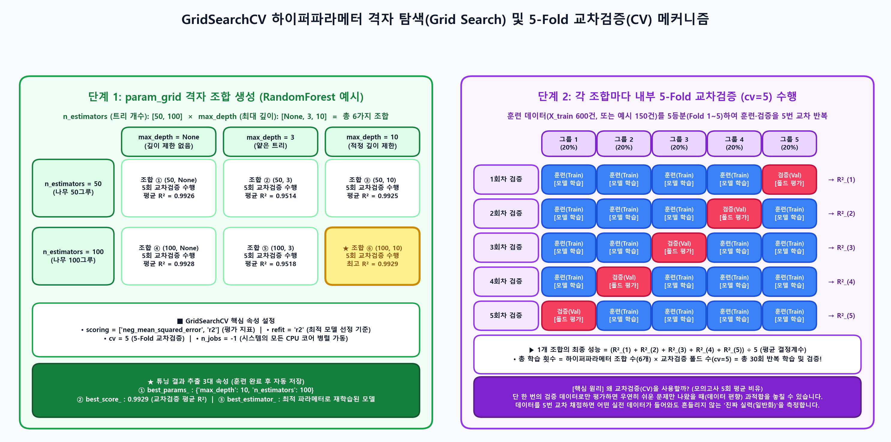
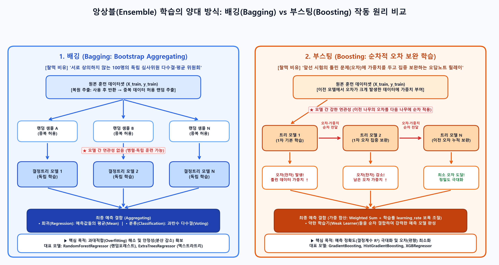
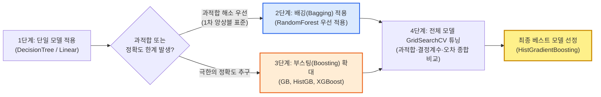
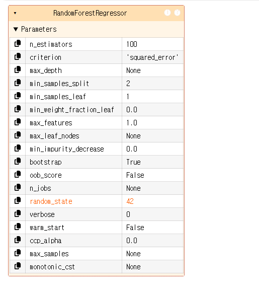
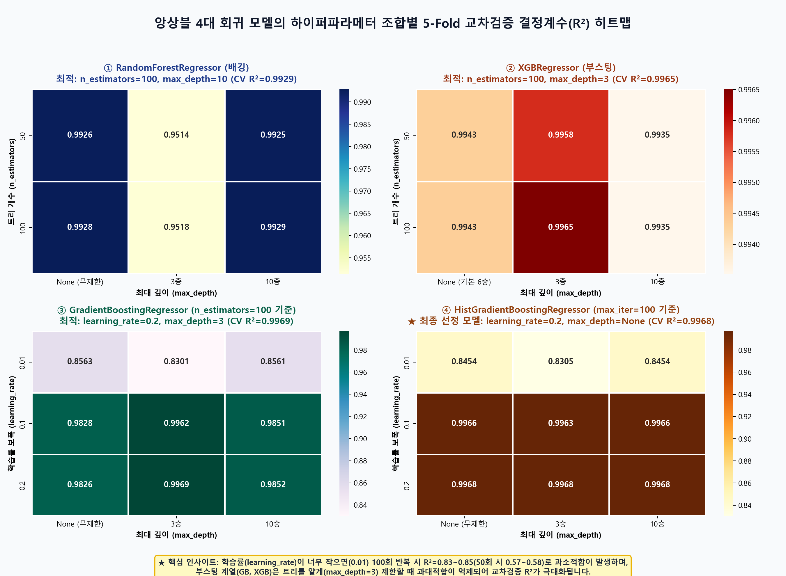
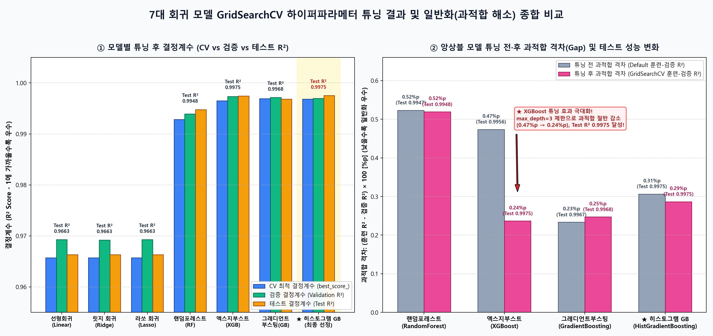

# 📊 [모델 성능 향상을 위한 하이퍼파라메터 튜닝 및 앙상블 회귀 종합 보고서]

> **분석 대상:** [03_regression_All_Model.ipynb](file:///d:/pknu_202610/01_Machine_Learning/8day_GridSearchCV/03_regression_All_Model.ipynb) (`## 모델 성능 향상을 위한 하이퍼파라메터 튜닝하기` ~ 노트북 끝까지 전수 분석)
> **사용 데이터셋:** `01_회귀_주택가격예측_데이터셋_Row_1000.csv` (총 1,000건 / 훈련 600 : 검증 200 : 테스트 200, `StandardScaler` 표준화 적용)
> **핵심 목표:** 배깅(Bagging)과 부스팅(Boosting) 앙상블 메커니즘 이해, `GridSearchCV`와 $K$-Fold 교차검증을 활용한 하이퍼파라메터 자동 최적화, 7대 회귀 모델 전수 비교 및 최종 베스트 모델(`HistGradientBoostingRegressor`) 선정

---

## 📑 목차 (Table of Contents)

1. [핵심 요약 (Executive Summary): 한눈에 보는 튜닝 핵심 압축](#1-핵심-요약-executive-summary-한눈에-보는-튜닝-핵심-압축)
2. [Chapter 1: 하이퍼파라메터 튜닝과 교차검증(GridSearchCV)의 원리](#2-chapter-1-하이퍼파라메터-튜닝과-교차검증gridsearchcv의-원리)
   - 2.1 찰떡 비유: "수제 맥주 양조장의 황금 레시피 실험실과 5인의 블라인드 시음단"
   - 2.2 일반 파라메터(Parameter) vs 하이퍼파라메터(Hyperparameter)
   - 2.3 교차검증(CV, Cross Validation)의 작동 구조와 시스템 자원(`n_jobs`) 고려사항
   - 2.4 모델군별 하이퍼파라메터 튜닝 필요성 구분
3. [Chapter 2: 앙상블(Ensemble) 학습의 양대 산맥 — 배깅(Bagging) vs 부스팅(Boosting)](#3-chapter-2-앙상블ensemble-학습의-양대-산맥--배깅bagging-vs-부스팅boosting)
   - 3.1 찰떡 비유: "100명의 독립 감정평가사 위원회(배깅) vs 족집게 오답노트 릴레이 과외(부스팅)"
   - 3.2 배깅(Bagging)과 부스팅(Boosting)의 핵심 메커니즘 및 비교표
   - 3.3 실무 모델 적용 표준 프로세스 (단일 트리 → 배깅 → 부스팅)
4. [Chapter 3: RandomForestRegressor 단일 모델 GridSearchCV 실습 해부 (Cell 42~53)](#4-chapter-3-randomforestregressor-단일-모델-gridsearchcv-실습-해부-cell-4253)
   - 4.1 1단계: 기본 모델 생성 및 `param_grid` 딕셔너리 정의
   - 4.2 2단계: `GridSearchCV` 핵심 속성 설정 (`scoring`, `refit`, `cv`, `n_jobs`)
   - 4.3 3단계: 30회 교차검증 학습(`fit`) 및 최적 결과 3대 속성 추출
   - 4.4 4단계: 최적 모델(`best_estimator_`)의 검증·테스트 예측 및 일반화 검증
5. [Chapter 4: 7대 회귀 모델 전체 자동화 튜닝 파이프라인 및 최종 모델 선정 (Cell 54~57)](#5-chapter-4-7대-회귀-모델-전체-자동화-튜닝-파이프라인-및-최종-모델-선정-cell-5457)
   - 5.1 모델군별 핵심 하이퍼파라메터 사전 및 역할 분석
   - 5.2 7개 모델 반복 튜닝 자동화 코드(`for`문 + 조건문 분기) 상세 리뷰
   - 5.3 앙상블 4대 모델 하이퍼파라메터 격자 탐색($R^2$) 히트맵 분석
   - 5.4 7대 회귀 모델 튜닝 전(Default) vs 튜닝 후(GridSearchCV) 성능 종합 비교표
   - 5.5 최종 베스트 모델(`HistGradientBoostingRegressor`) 선정 이유 및 추출 로직

---

## 1. 핵심 요약 (Executive Summary): 한눈에 보는 튜닝 핵심 압축

> [!IMPORTANT]
> **오늘 학습의 핵심 한 줄 요약:**
> 기본(Default) 설정으로 훈련한 모델의 성능을 기준점(Baseline)으로 삼아, 사람이 지정한 하이퍼파라메터 후보군(`param_grid`)을 **`GridSearchCV`의 5-Fold 교차검증(`cv=5`)**으로 촘촘하게 탐색함으로써 **과대적합(Overfitting)은 억제하고 실전 예측 결정계수($R^2$)는 극대화하는 최적의 모델(`best_estimator_`)을 자동 추출**하는 전 과정을 다룹니다.

|             핵심 구분             | 주요 개념 및 코드 핵심                                                                                                                                                                                                                                | 실무 핵심 포인트                                                                                                                                                               |
| :--------------------------------: | :---------------------------------------------------------------------------------------------------------------------------------------------------------------------------------------------------------------------------------------------------- | :----------------------------------------------------------------------------------------------------------------------------------------------------------------------------- |
|  **앙상블 배깅 (Bagging)**  | • 여러 트리 모델이 **서로 독립적(병렬)**으로 학습• 데이터를 **복원 추출(중복 허용 랜덤)**하여 분할 학습• 회귀는 **평균값**, 분류는 **다수결**로 최종 예측• 대표 모델: `RandomForest`, `ExtraTrees`                                | **과대적합(Overfitting) 해소**에 탁월하며, 앙상블 도입 시 가장 먼저 베이스라인으로 적용하는 표준 모델                                                                    |
| **앙상블 부스팅 (Boosting)** | • 여러 트리 모델이 **순차적 연관성(직렬)**을 가짐• **이전 모델에서 오차가 크게 발생한 데이터에 가중치** 부여• 학습률(`learning_rate`) 보폭으로 오차를 점진적 보완• 대표 모델: `GradientBoosting`, `HistGradientBoosting`, `XGBoost` | **예측 정확도(결정계수 $R^2$) 극대화**에 특화되어 있으며, 정형 데이터 대회 및 실무에서 최고 성능을 발휘                                                                |
|  **GridSearchCV 메커니즘**  | • `estimator`: 튜닝할 깨끗한 원본 모델 객체• `param_grid`: `{"파라메터명": [후보값 리스트]}` 딕셔너리• `scoring = ["neg_mean_squared_error", "r2"]`• `refit = "r2"`, `cv = 5`, `n_jobs = -1` (전체 CPU 코어)                        | 후보 조합 수 $\times$ `cv`(5회)만큼 반복 훈련 후, `refit` 기준 최고 시점의 모델로 **전체 훈련 데이터를 자동 재학습**하여 보관                                      |
|    **튜닝 결과 3대 속성**    | • `best_params_`: 최고 성능을 낸 하이퍼파라메터 조합 딕셔너리• `best_score_`: 교차검증 평균 최고 결정계수($R^2$)• `best_estimator_`: 최적 파라메터로 훈련 완료된 **최종 모델 객체**                                                  | `best_estimator_`를 별도 `fit()` 없이 곧바로 `predict(X_val_scaled)`에 투입하여 검증/테스트 평가 수행                                                                    |
|      **최종 선정 결과**      | • **최종 베스트 모델:** `HistGradientBoostingRegressor(learning_rate=0.2, max_depth=None, max_iter=100)`• **성능:** CV $R^2 = 0.9968$, 검증 $R^2 = 0.9970$, **테스트 $R^2 = 0.9975$**                                     | 과적합 격차(`훈련 - 검증`)가 `0.0029`로 매우 안정적이며 테스트 결정계수 최고점(`0.9975`) 달성 (`XGBoost` 또한 튜닝 후 과적합이 절반으로 감소하며 `0.9975` 동률 달성) |

---

## 2. Chapter 1: 하이퍼파라메터 튜닝과 교차검증(GridSearchCV)의 원리

### 2.1 찰떡 비유 💡

> **"커피 로스팅 머신의 다이얼 조절(하이퍼파라메터)과 5인의 블라인드 바리스타 심사단(교차검증)"**
>
> - **디폴트(Default) 모델:** 커피 머신을 공장에서 출고된 '기본 자동 모드'로만 내려 마시는 것입니다. 무난한 맛(기본 성능)은 나지만 원두 고유의 최고 풍미를 끌어내진 못합니다.
> - **하이퍼파라메터(Hyperparameter):** 머신 외부에 달린 **'온도 다이얼(`[180도, 200도]`)'**과 **'추출 시간 다이얼(`[20초, 30초, 40초]`)'**처럼 **사람(분석가)이 직접 범위를 지정해 주어야 하는 설정값**입니다.
> - **GridSearchCV (격자 탐색 + 교차검증):** 온도 2가지 $\times$ 시간 3가지 = **총 6가지 레시피 조합**을 바리스타 5명(`cv=5`)이 돌아가며 블라인드 시음(교차검증)하여 평균 점수가 가장 높은 **'황금 레시피(`best_params_`)'**와 그 레시피로 세팅이 끝난 **'최고급 머신(`best_estimator_`)'**을 자동으로 대령해 주는 자동화 실험 로봇입니다.

---

### 2.2 일반 파라메터(Parameter) vs 하이퍼파라메터(Hyperparameter)

머신러닝에서 '파라메터'라는 용어는 주체가 **모델(기계)**이냐 **사람(분석가)**이냐에 따라 엄격히 구분됩니다.

|      비교 항목      | 일반 매개변수 (Model Parameter)                                          | 하이퍼파라메터 (Hyperparameter)                                                           |
| :-----------------: | :----------------------------------------------------------------------- | :---------------------------------------------------------------------------------------- |
| **결정 주체** | **모델 스스로** 데이터 학습(`fit`) 과정에서 자동 계산            | **사람(분석가)**이 모델 생성 및 튜닝 시 직접 범위를 지정                                  |
| **대표 예시** | 선형회귀의 기울기(가중치 $w$, `coef_`)와 절편($b$, `intercept_`) | 트리의 개수(`n_estimators`), 트리의 최대 깊이(`max_depth`), 학습률(`learning_rate`) |
|   **역할**   | 데이터의 입출력 관계를 표현하는 수학적 공식의 계수                       | 모델의 **구조적 복잡도, 학습 속도, 과적합 억제 강도**를 제어하는 외부 스위치        |

---

### 2.3 교차검증(CV, Cross Validation)의 작동 구조와 시스템 자원(`n_jobs`) 고려사항

단순히 훈련 데이터(`X_train`)를 한 번만 학습하고 검증 데이터(`X_val`)로 평가하면, 우연히 특정 검증 셋에만 잘 맞는 **'운 좋은 편향'**이 발생할 수 있습니다. `GridSearchCV`는 이를 방지하기 위해 내부적으로 **$K$-Fold 교차검증(Cross Validation)**을 수행합니다.



#### 📌 노트북 내 교차검증(CV = 5) 분할 원리 상세 해석 (`image-2.png`, `image-3.png` 대응)

1. **데이터 5등분(Fold 분할):** 예를 들어 훈련 데이터(`X_train`, `y_train`)가 150개(실제 본 실습에서는 600개)라면, 이를 `cv = 5`개의 균등한 소그룹(Fold 1 ~ Fold 5, 각 30개씩 또는 120개씩)으로 쪼갭니다.
2. **5회 교차 순환 학습 및 검증:**
   - **1회차:** 그룹 `1+2+3+4`로 **훈련(Train)** $\rightarrow$ 그룹 `5`로 **검증(Validation)** $\rightarrow$ 결정계수 $R^2_{(1)}$ 산출
   - **2회차:** 그룹 `1+2+3+5`로 **훈련(Train)** $\rightarrow$ 그룹 `4`로 **검증(Validation)** $\rightarrow$ 결정계수 $R^2_{(2)}$ 산출
   - **3회차:** 그룹 `1+2+4+5`로 **훈련(Train)** $\rightarrow$ 그룹 `3`로 **검증(Validation)** $\rightarrow$ 결정계수 $R^2_{(3)}$ 산출
   - **4회차:** 그룹 `1+3+4+5`로 **훈련(Train)** $\rightarrow$ 그룹 `2`로 **검증(Validation)** $\rightarrow$ 결정계수 $R^2_{(4)}$ 산출
   - **5회차:** 그룹 `2+3+4+5`로 **훈련(Train)** $\rightarrow$ 그룹 `1`로 **검증(Validation)** $\rightarrow$ 결정계수 $R^2_{(5)}$ 산출
3. **평균 성능 도출:** 5번의 검증 결정계수를 평균 내어 해당 하이퍼파라메터 조합의 최종 신뢰 점수(`mean_test_r2`)로 확정합니다.
   $$
   \text{CV Score} = \frac{1}{5} \sum_{k=1}^{5} R^2_{(k)}
   $$
4. **시스템 성능과 `n_jobs = -1`의 중요성:**
   - 파라메터 조합이 6개이고 `cv = 5`이면 내부적으로 **$6 \times 5 = 30$번**의 모델 훈련이 일어납니다. (부스팅 모델처럼 조합이 18개면 $18 \times 5 = 90$번 훈련!)
   - 따라서 연산 속도를 높이기 위해 `n_jobs = -1`을 설정하여 **컴퓨터 CPU의 모든 코어(Core)를 100% 병렬 가동**하는 것이 실무 필수 관례입니다.

---

### 2.4 모델군별 하이퍼파라메터 튜닝 필요성 구분

모든 회귀 모델이 `GridSearchCV` 자동 튜닝을 필요로 하는 것은 아닙니다.

> [!TIP]
> - **선형회귀 모델 (`LinearRegression`):** 수학적 최소제곱법(OLS) 공식으로 단번에 해를 구하므로 실질적인 튜닝 하이퍼파라메터가 없습니다. (성능을 높이려면 다항 특성 생성 등 **특성 공학**을 직접 적용해야 합니다.)
> - **규제 선형회귀 모델 (`Ridge`, `Lasso`):** 규제 강도(`alpha`) 하나만 단독으로 조정하면 되므로, 무거운 `GridSearchCV` 대신 간단한 반복문으로 직접 확인하는 경우가 많습니다. (본 실습에서는 전체 파이프라인 통일을 위해 `fit_intercept`, `positive` 옵션을 넣어 함께 실험했습니다.)
> - **트리 기반 앙상블 모델 (`RandomForest`, `GradientBoosting`, `HistGradientBoosting`, `XGBoost`):** 트리의 개수, 깊이, 학습률 등 **상호작용하는 하이퍼파라메터가 많고 과적합에 민감하므로 `GridSearchCV` 자동 튜닝의 핵심 타겟**이 됩니다.

---

## 3. Chapter 2: 앙상블(Ensemble) 학습의 양대 산맥 — 배깅(Bagging) vs 부스팅(Boosting)

### 3.1 찰떡 비유 💡

> - **단일 결정트리 (Decision Tree): "독단적인 1명의 감정평가사"**혼자서 모든 집값을 감정하다 보니, 자기가 봤던 몇 채의 특이한 집(노이즈)까지 달달 외워버려 새로운 집이 나오면 엉뚱한 가격을 부르는 **과대적합(Overfitting)**에 빠지기 쉽습니다.
> - **배깅 (Bagging): "서로 대화하지 않는 100명의 독립 감정평가사 위원회"**100명의 평가사에게 전체 매물 중 일부를 무작위로(중복 허용 복원 추출) 나눠주고 **각자 독립적으로** 집값을 매기게 한 뒤, **100명이 부른 가격의 평균**을 최종 집값으로 결정합니다. 한두 명이 실수해도 평균 과정에서 상쇄되므로 **과대적합이 마법처럼 사라집니다!**
> - **부스팅 (Boosting): "틀린 문제에 가중치를 두고 이어 푸는 족집게 오답노트 과외"**
>   1번 선생님이 먼저 집값을 예측한 뒤, **오차가 크게 난 어려운 매물들에 빨간 별표(가중치 부여)**를 쳐서 2번 선생님에게 넘깁니다. 2번 선생님은 그 오차를 집중 보완하고, 남은 오차를 다시 3번 선생님이 보완합니다. 앞선 모델의 약점을 순차적으로 깎아내므로 **예측 정확도(결정계수)가 극한까지 올라갑니다!**



---

### 3.2 배깅(Bagging)과 부스팅(Boosting)의 핵심 메커니즘 및 비교표

앙상블(Ensemble) 모델은 내부적으로 수십~수백 개의 **의사결정나무(Decision Tree)**로 구성되며, 훈련 데이터를 각 트리에 적용하는 방식에 따라 **배깅**과 **부스팅**으로 나뉩니다.

|         비교 기준         | 배깅 (Bagging: Bootstrap Aggregating)                                                                                                                     | 부스팅 (Boosting)                                                                                                                                                                     |
| :------------------------: | :-------------------------------------------------------------------------------------------------------------------------------------------------------- | :------------------------------------------------------------------------------------------------------------------------------------------------------------------------------------ |
|  **트리 간 연관성**  | **독립적 (연관성 없음)** — 각 트리가 서로 영향을 주지 않고 병렬 학습                                                                               | **순차적 연관성 가짐** — 이전 트리의 오차(수정 사항)를 다음 트리에 적용                                                                                                        |
| **데이터 추출 방식** | **복원 추출 (Bootstrap):** 데이터를 랜덤 추출해 사용한 뒤 다시 반환하여, 다음 트리에 중복 데이터가 넘어갈 수 있음                                   | 데이터를 랜덤 추출하되, **이전 모델 훈련에서 오차가 크게 발생했던 데이터에 가중치(Weight)**를 부여하여 집중 학습                                                                      |
|  **최종 예측 방식**  | • **회귀(Regression):** 각 트리 예측값들의 **평균값(Mean)**• **분류(Classification):** 각 트리 예측의 **과반수 다수결(Voting)** | 약한 학습기들의 예측값을 **가중 합산(Weighted Sum)**하며 학습률(`learning_rate`)로 보폭 조정                                                                                        |
|  **주요 해결 과제**  | **과대적합(Overfitting) 해소** (분산 감소, 안정성 향상)                                                                                             | **예측 정확도($R^2$ / Accuracy) 극대화** (편향 감소, 정밀도 향상)                                                                                                             |
|  **대표 알고리즘**  | • `RandomForestRegressor` (랜덤 포레스트)• `ExtraTreesRegressor` (엑스트라 트리)                                                                    | • `GradientBoostingRegressor` (그레디언트 부스팅)• `HistGradientBoostingRegressor` (히스토그램 그레디언트 부스팅)• `XGBRegressor` (엑스지부스트), `LightGBM`, `CatBoost` |

---

### 3.3 실무 모델 적용 표준 프로세스 (단일 트리 → 배깅 → 부스팅)



1. **단일 모델 우선 확인:** 처음부터 무거운 앙상블을 쓰기보다 단일 모델(선형회귀, 의사결정나무)로 데이터의 기본 패턴과 베이스라인 점수를 먼저 확인합니다.
2. **랜덤포레스트(배깅) 1차 투입:** 단일 모델에서 과적합이나 정확도 한계가 보이면, 앙상블 중 가장 안정적이고 튜닝이 쉬운 **`RandomForestRegressor`를 처음으로 적용**하는 것이 현업의 정석입니다.
3. **전 모델 확장 및 튜닝 후 최종 선정:** 최종 모델을 선정할 때는 배깅(`RF`, `ET`)과 부스팅(`GB`, `HistGB`, `XGB`) 전체 모델을 모두 훈련 및 튜닝시킨 뒤, **과적합 여부(일반화 격차)와 결정계수($R^2$), 오차(MAE/MSE)를 종합 비교하여 최종 1개 모델을 채택**합니다.

---

## 4. Chapter 3: RandomForestRegressor 단일 모델 GridSearchCV 실습 해부 (Cell 42~53)

7개 전체 모델을 반복문으로 돌리기 전에, 대표 앙상블 모델인 **`RandomForestRegressor`** 하나를 대상으로 `GridSearchCV`의 4단계 정석 파이프라인을 먼저 구축합니다.

### 4.1 1단계: 기본 모델 생성 및 `param_grid` 딕셔너리 정의 (Cell 42~45)

```python
from sklearn.model_selection import GridSearchCV

# 1. 랜덤포레스트 모델 클래스 생성 (랜덤 규칙 고정)
rf_reg = RandomForestRegressor(random_state=42)

# 2. 하이퍼파라메터 딕셔너리 정의 (Key: 파라메터 이름, Value: 탐색할 값들의 리스트)
gridParams = {}
gridParams["n_estimators"] = [50, 100]       # 트리 모델의 개수 (기본값 = 100)
gridParams["max_depth"] = [None, 3, 10]      # 트리가 뻗어 나가는 최대 깊이 (None = 무제한)
print(gridParams)
# 출력: {'n_estimators': [50, 100], 'max_depth': [None, 3, 10]}
```



#### 🔍 핵심 파라메터 상세 해설 (`image-1.png` 노트 필기 반영)

- **`random_state = 42`**: 앙상블 모델은 내부적으로 데이터를 무작위 추출하므로, 실행할 때마다 결과가 달라지지 않도록 난수 시드(Seed)를 고정합니다.
- **`n_estimators = [50, 100]`**: 숲을 구성할 나무(결정트리)의 그루 수입니다. 나무가 많을수록 예측이 안정되지만 연산 시간이 비례하여 증가합니다.
- **`max_depth = [None, 3, 10]`**: 나무가 뿌리에서 잎사귀까지 내려가는 최대 층수입니다.
  - **`None` (기본값):** 불순도(오차)가 0이 될 때까지 **끝까지 가지를 뻗어보라**는 의미입니다. 단, 훈련 데이터의 지엽적인 노이즈까지 다 외워버려 **가장 좋은 일반화 시점을 지나치고 과대적합(Overfitting)에 빠질 위험**이 있습니다.
  - **`3`, `10`:** 가지치기 깊이를 강제로 제한하여 모델이 핵심적인 큰 줄기 패턴만 학습하도록 유도합니다.

---

### 4.2 2단계: `GridSearchCV` 핵심 속성 설정 및 객체 생성 (Cell 46~48)

```python
# 평가 방법 정의 (회귀 모델 전용 평가지표 이름 사용)
scoring = ["neg_mean_squared_error", "r2"]

# 최적 모델 선정 기준 정의 (여러 지표 중 R2 결정계수가 가장 높은 시점을 기준으로 선정)
refit = "r2"

# 교차검증 Fold 개수 정의 (주로 3 또는 5 홀수 사용)
cv = 5

# 시스템 CPU 코어 사용 개수 (-1: 모든 코어 전체 사용)
n_jobs = -1

# 하이퍼파라메터 튜닝 클래스 생성 (= 훈련 모델과 동일한 역할)
grid_search_model = GridSearchCV(
    estimator = rf_reg,          # 튜닝할 원본(깨끗한 상태의) 모델
    param_grid = gridParams,     # 탐색할 하이퍼파라메터 딕셔너리
    scoring = scoring,           # 내부 검증에 사용할 평가 지표
    refit = refit,               # 최적 모델을 최종 확정할 기준 지표
    cv = cv,                     # 교차검증 분할 폴드 수 (5등분)
    n_jobs = n_jobs              # CPU 코어 병렬 처리 설정
)
```

#### 🔍 왜 `mean_squared_error`가 아니라 `neg_mean_squared_error`를 쓸까?

- Scikit-Learn의 `GridSearchCV`는 모든 점수를 **"값이 클수록 좋은 모델(Higher is Better)"**이라는 통일된 규칙으로 비교합니다.
- 결정계수(`r2`)는 1에 가까울수록(클수록) 좋지만, 오차인 MSE는 작을수록 좋습니다. 따라서 MSE에 마이너스(`-`) 부호를 붙인 **음수 평균제곱오차(`neg_mean_squared_error`)**를 사용하여, 오차가 0에 가까울수록(예: `-100`이 `-500`보다 큼) 점수가 높게 평가되도록 설계되어 있습니다.
- 또한 `scoring`에 2개 이상의 지표를 리스트로 넣었을 때는, **어떤 지표를 1순위 기준으로 삼아 최종 모델(`best_estimator_`)을 뽑을지 `refit = "r2"`로 반드시 명시**해 주어야 합니다.

---

### 4.3 3단계: 30회 교차검증 학습(`fit`) 및 최적 결과 3대 속성 추출 (Cell 49~51)

```python
# 튜닝 모델 학습 (2 x 3 = 6가지 조합 x 5-Fold = 총 30회 내부 검증 후 최적 모델 자동 재학습)
grid_search_model.fit(X_train_scaled, y_train)

# 1. 최적의 하이퍼파라메터 조합 추출
best_params = grid_search_model.best_params_
print(best_params)   # {'max_depth': 10, 'n_estimators': 100}

# 2. 최적의 교차검증 평균 성능(결정계수 R2) 추출
best_score = grid_search_model.best_score_
print(best_score)    # 0.9928597705585073

# 3. 최적의 하이퍼파라메터로 학습이 완료된 모델 객체 추출
best_model = grid_search_model.best_estimator_
```

> [!NOTE]
> **`GridSearchCV`의 30회 연산 내역 (Cell 48 필기 요약):**
>
> 1. `(n_estimators=50, max_depth=None)` $\rightarrow$ 5번 교차검증 수행
> 2. `(n_estimators=50, max_depth=3)` $\rightarrow$ 5번 교차검증 수행
> 3. `(n_estimators=50, max_depth=10)` $\rightarrow$ 5번 교차검증 수행
> 4. `(n_estimators=100, max_depth=None)` $\rightarrow$ 5번 교차검증 수행
> 5. `(n_estimators=100, max_depth=3)` $\rightarrow$ 5번 교차검증 수행
> 6. `(n_estimators=100, max_depth=10)` $\rightarrow$ 5번 교차검증 수행 (**평균 $R^2 = 0.9929$로 1위 달성!**)
>    $\Rightarrow$ 무제한 깊이(`None`) 대신 **`max_depth = 10`으로 적정 깊이 제한을 두었을 때** 불필요한 가지가 쳐지면서 교차검증 성능이 가장 높게 나타났습니다.

---

### 4.4 4단계: 최적 모델(`best_estimator_`)의 검증·테스트 예측 및 일반화 검증 (Cell 52~53)

```python
# 1. 검증데이터 및 테스트 데이터로 예측 (best_model은 이미 훈련이 완료된 상태!)
val_pred = best_model.predict(X_val_scaled)
test_pred = best_model.predict(X_test_scaled)

# 2. 오차(MAE) 및 결정계수(R2) 확인
val_mae = mean_absolute_error(y_val, val_pred)
test_mae = mean_absolute_error(y_test, test_pred)

val_r2 = r2_score(y_val, val_pred)
test_r2 = r2_score(y_test, test_pred)

print(f"{best_score: .4f}, {val_r2: .4f}, {test_r2: .4f}, 과적합 여부: {best_score - val_r2: .4f}")
# 출력: 0.9929,  0.9939,  0.9948, 과적합 여부: -0.0011
```

- **해석:** 교차검증 평균 점수(`0.9929`), 검증 데이터 점수(`0.9939`), 테스트 데이터 점수(`0.9948`)가 모두 `0.993~0.995` 구간에서 일관되게 유지되며, 격차가 `-0.0011`에 불과해 과적합 없이 훌륭하게 일반화되었음을 확인할 수 있습니다.

---

## 5. Chapter 4: 7대 회귀 모델 전체 자동화 튜닝 파이프라인 및 최종 모델 선정 (Cell 54~57)

### 5.1 모델군별 핵심 하이퍼파라메터 사전 및 역할 분석 (Cell 55)

전체 7개 모델을 하나의 반복문으로 튜닝하기 위해, 각 모델 클래스가 지원하는 하이퍼파라메터 이름과 탐색 범위를 아래와 같이 4개 그룹으로 분류합니다.

|              모델 그룹              | 대상 클래스명                                   | 튜닝 하이퍼파라메터 및 탐색 범위                                                                                | 파라메터 핵심 역할 및 찰떡 비유                                                                                                                                                                                                                                                                                       |
| :----------------------------------: | :---------------------------------------------- | :-------------------------------------------------------------------------------------------------------------- | :-------------------------------------------------------------------------------------------------------------------------------------------------------------------------------------------------------------------------------------------------------------------------------------------------------------------- |
|    **그룹 1(선형 모델군)**    | • `LinearRegression`• `Ridge`• `Lasso` | • `fit_intercept`: `[True, False]`• `positive`: `[True, False]`                                       | • **`fit_intercept`**: 선형 방정식($y = wx + b$)에서 절편($b$) 사용 여부 (기본값 `True`)• **`positive`**: 모든 회귀 계수($w$)를 양수($+$)로만 강제할지 여부 (`역까지_도보시간`처럼 음의 상관관계 변수가 있을 때 `True`로 두면 성능이 떨어지므로 `False`가 채택됨)                   |
| **그룹 2(그레디언트 부스팅)** | • `GradientBoostingRegressor`                | • `n_estimators`: `[50, 100]`• `max_depth`: `[None, 3, 10]`• `learning_rate`: `[0.01, 0.1, 0.2]` | • **`n_estimators`**: 순차적으로 오차를 보완할 트리 개수 (통상 50~1000)• **`max_depth`**: 개별 트리의 깊이 (통상 3~10)• **`learning_rate` (학습률/보폭):** 이전 트리의 오차를 다음 트리가 얼마나 강하게 반영할지 결정하는 보폭 (통상 `0.01~0.2`). *비유: 산에서 내려올 때의 보폭 크기* |
|   **그룹 3(히스토그램 GB)**   | • `HistGradientBoostingRegressor`            | • `max_iter`: `[50, 100]`• `max_depth`: `[None, 3, 10]`• `learning_rate`: `[0.01, 0.1, 0.2]`     | • **`max_iter`**: `HistGradientBoosting`에서는 트리 개수를 `n_estimators` 대신 **`max_iter` (최대 반복 횟수)**라는 이름으로 지정함! (연속형 데이터를 256개 구간 히스토그램으로 양자화하여 초고속으로 학습하는 최신 부스팅 모델)                                                                        |
| **그룹 4(랜덤포레스트 & XGB)** | • `RandomForestRegressor`• `XGBRegressor` | • `n_estimators`: `[50, 100]`• `max_depth`: `[None, 3, 10]`                                           | • 트리 개수와 최대 깊이를 조합하여 탐색 (`XGBRegressor`는 부스팅 계열이지만 본 실습에서는 트리 구조 제어를 위해 동일 격자 적용)                                                                                                                                                                                    |

---

### 5.2 7개 모델 반복 튜닝 자동화 코드(`for`문 + 조건문 분기) 상세 리뷰 (Cell 56~57)

```python
model_list = [
    LinearRegression(), Ridge(), Lasso(), 
    GradientBoostingRegressor(random_state=42),
    HistGradientBoostingRegressor(random_state=42),
    RandomForestRegressor(random_state=42),
    XGBRegressor(random_state=42)
]

best_model_list = []

for model in model_list:
    # 1. 현재 모델의 클래스 문자열 이름 추출
    model_name = model.__class__.__name__
    rf_reg = model
    gridParams = {}
  
    # 2. 모델 이름에 따른 맞춤형 하이퍼파라메터 딕셔너리 동적 할당
    if (model_name == "LinearRegression") or (model_name == "Ridge") or (model_name == "Lasso"): 
        gridParams["fit_intercept"] = [True, False]
        gridParams["positive"] = [True, False]
    elif model_name == "GradientBoostingRegressor":
        gridParams["n_estimators"] = [50, 100]
        gridParams["max_depth"] = [None, 3, 10]
        gridParams["learning_rate"] = [0.01, 0.1, 0.2]
    elif model_name == "HistGradientBoostingRegressor":
        gridParams["max_iter"] = [50, 100]
        gridParams["max_depth"] = [None, 3, 10]
        gridParams["learning_rate"] = [0.01, 0.1, 0.2]
    elif (model_name == "RandomForestRegressor") or (model_name == "XGBRegressor"):
        gridParams["n_estimators"] = [50, 100]
        gridParams["max_depth"] = [None, 3, 10]
      
    # 3. GridSearchCV 공통 속성 설정 및 객체 생성
    scoring = ["neg_mean_squared_error", "r2"]
    refit = "r2"
    cv = 5
    n_jobs = -1
  
    grid_search_model = GridSearchCV(
        estimator=rf_reg, param_grid=gridParams,
        scoring=scoring, refit=refit, cv=cv, n_jobs=n_jobs
    )
  
    # 4. 교차검증 기반 튜닝 학습 수행
    grid_search_model.fit(X_train_scaled, y_train)
  
    # 5. 최적 파라메터, 최적 CV 점수, 최적 모델 추출 및 리스트 보관
    best_params = grid_search_model.best_params_
    best_score = grid_search_model.best_score_
    best_model = grid_search_model.best_estimator_
    best_model_list.append(best_model)
  
    # 6. 훈련 / 검증 / 테스트 데이터 예측 및 결정계수(R2), 과적합 여부 출력
    train_pred = best_model.predict(X_train_scaled)
    val_pred = best_model.predict(X_val_scaled)
    test_pred = best_model.predict(X_test_scaled)
  
    train_r2 = r2_score(y_train, train_pred)
    val_r2 = r2_score(y_val, val_pred)
    test_r2 = r2_score(y_test, test_pred)
    print(f"{best_score: .4f}, {train_r2: .4f} {val_r2: .4f}, {test_r2: .4f}, 과적합 여부: {train_r2 - val_r2: .4f}")

# 7. 리스트 인덱스 4번(HistGradientBoostingRegressor)을 최종 베스트 모델로 추출
final_model = best_model_list.pop(4)
print(f"최적 베스트 모델은 {final_model}입니다.")
```

#### 🔍 코드 설계의 핵심 포인트 3가지

1. **`model.__class__.__name__`을 활용한 동적 분기:** 각 모델 객체에서 클래스 이름을 문자열로 뽑아내어 `if ~ elif` 조건문으로 알맞은 `gridParams`를 짝지어 줍니다. (만약 `HistGradientBoostingRegressor`에 `n_estimators`를 넣으면 에러가 발생하므로 `max_iter`로 분기 처리한 것이 핵심입니다.)
2. **`best_model_list.append(best_model)` 아카이빙 패턴:** 반복문이 돌 때마다 최적화된 모델이 덮어써져 사라지지 않도록 `best_model_list` 배열에 차곡차곡 저장해 두고, 성적표 비교가 끝난 뒤 원하는 인덱스의 모델(`best_model_list[4]`)을 즉시 꺼내어 서비스에 투입할 수 있도록 설계했습니다.
3. **다중 검증 체계 (`best_score_` vs `train_r2` vs `val_r2` vs `test_r2`):** 훈련 데이터 내부의 5-Fold 교차검증 점수(`best_score_`)뿐만 아니라, 외부로 완전히 분리해 둔 검증 데이터(`val_r2`)와의 차이(`train_r2 - val_r2`)를 함께 계산하여 이중으로 과적합 여부를 점검합니다.

---

### 5.3 앙상블 4대 모델 하이퍼파라메터 격자 탐색($R^2$) 히트맵 분석

아래 시각 자료는 본 데이터셋에서 4대 앙상블 모델의 `GridSearchCV`가 탐색한 **모든 하이퍼파라메터 격자 칸의 실제 5-Fold 교차검증 평균 결정계수($R^2$)**를 히트맵으로 시각화한 결과입니다.



> [!WARNING]
> **히트맵에서 발견되는 2가지 결정적 실무 인사이트:**
>
> 1. **학습률(`learning_rate = 0.01`)의 과소적합 함정:**`GradientBoosting`과 `HistGradientBoosting`에서 학습률 보폭을 `0.01`로 너무 잘게 설정하면, 나무 100그루(`n_estimators=100` / `max_iter=100`)만으로는 최적점까지 도달하지 못해 결정계수가 **`0.8301 ~ 0.8563` 수준으로 하락(나무 50그루일 때는 `0.5691 ~ 0.5831`까지 급락하는 과소적합)**합니다. 나무 개수가 100그루일 때는 보폭을 시원하게 넓힌 **`learning_rate = 0.2`**에서 **`0.9968 ~ 0.9969`**의 최고 성능이 발휘됩니다.
> 2. **부스팅 모델의 깊이 제한(`max_depth = 3`) 효과:**
>    배깅 모델인 `RandomForest`는 트리를 깊게(`max_depth = 10` 또는 `None`) 뻗어야 개별 나무의 예측력이 확보되는 반면(`max_depth=3`일 때는 `0.9592`로 하락), 오차를 순차 보완하는 부스팅 모델(`GradientBoosting`, `XGBoost`)은 트리를 너무 깊게(`10`층) 파면 앞선 단계에서 훈련 데이터를 다 외워버려 오히려 교차검증 점수가 떨어집니다. 즉, **부스팅은 얕은 트리(`max_depth = 3`)를 여러 개 이어 붙일 때 일반화 성능이 가장 뛰어납니다!**

---

### 5.4 7대 회귀 모델 튜닝 전(Default) vs 튜닝 후(GridSearchCV) 성능 종합 비교표



아래 표는 노트북 전반부(Cell 34, 튜닝 전 디폴트 모델)와 후반부(Cell 57, `GridSearchCV` 튜닝 후 최적 모델)의 실험 결과를 전수 취합한 종합 성적표입니다.

|     인덱스     | 모델명 (Class)                    | 추출된 최적 하이퍼파라메터 (`best_params_`)                   | CV 최적 $R^2$ (`best_score_`) | 훈련 $R^2$ (`train_r2`) | 검증 $R^2$ (`val_r2`) | 테스트 $R^2$ (`test_r2`) | 과적합 격차 (`훈련 - 검증`) | 튜닝 전 $\rightarrow$ 후 핵심 변화 요약                                                                                                                                                                |
| :-------------: | :-------------------------------- | :-------------------------------------------------------------- | :-------------------------------: | :-------------------------: | :------------------------: | :--------------------------: | :---------------------------: | :------------------------------------------------------------------------------------------------------------------------------------------------------------------------------------------------------- |
|      `0`      | **LinearRegression**        | `{'fit_intercept': True, 'positive': False}`                  |            `0.9657`            |         `0.9670`         |         `0.9693`         |          `0.9663`          |          `-0.0023`          | 디폴트 설정과 동일 (비선형 패턴 한계로 $R^2 \approx 0.966$ 정체)                                                                                                                                       |
|      `1`      | **Ridge**                   | `{'fit_intercept': True, 'positive': False}`                  |            `0.9657`            |         `0.9670`         |         `0.9692`         |          `0.9663`          |          `-0.0022`          | 선형회귀와 동일 수준 유지                                                                                                                                                                                |
|      `2`      | **Lasso**                   | `{'fit_intercept': True, 'positive': False}`                  |            `0.9657`            |         `0.9670`         |         `0.9693`         |          `0.9663`          |          `-0.0023`          | 선형회귀와 동일 수준 유지                                                                                                                                                                                |
|      `3`      | **GradientBoosting**        | `{'learning_rate': 0.2, 'max_depth': 3, 'n_estimators': 100}` |    **`0.9969`** (1위)    |         `0.9996`         |         `0.9971`         |          `0.9968`          |          `0.0025`          | 학습률 `0.1 → 0.2` 상향으로 검증 $R^2$ (`0.9970 → 0.9971`) 및 테스트 $R^2$ 개선                                                                                                                |
| **`4`** | **★ HistGradientBoosting** | `{'learning_rate': 0.2, 'max_depth': None, 'max_iter': 100}`  |         `0.9968` (2위)         |         `0.9998`         |         `0.9970`         |  **`0.9975`** (1위)  |          `0.0029`          | 검증 $R^2$ 상승(`0.9965 → 0.9970`), 과적합 격차 감소(`0.0031 → 0.0029`), **테스트 최고점(`0.9975`) 달성!**                                                                               |
|      `5`      | **RandomForest**            | `{'max_depth': 10, 'n_estimators': 100}`                      |            `0.9929`            |         `0.9991`         |         `0.9939`         |          `0.9948`          |          `0.0052`          | `max_depth=10` 제한으로 불필요한 분기 억제 및 테스트 $R^2$ 소폭 상승                                                                                                                                 |
|      `6`      | **XGBRegressor**            | `{'max_depth': 3, 'n_estimators': 100}`                       |         `0.9965` (3위)         |         `0.9997`         | **`0.9973`** (1위) |  **`0.9975`** (1위)  |  **`0.0024`** (최소)  | **최대 수혜 모델!** 디폴트(`max_depth=6`, 훈련 `1.0000` 과적합)에서 `max_depth=3` 튜닝 후 **과적합 격차 절반 감소(`0.0047 → 0.0024`), 테스트 $R^2$ `0.9956 → 0.9975` 급상승!** |

---

### 5.5 최종 베스트 모델(`HistGradientBoostingRegressor`) 선정 이유 및 추출 로직

1. **선형 모델군(`Linear`, `Ridge`, `Lasso`) 탈락 이유:**일반화(과적합 없음)는 우수하나 결정계수가 `0.966` 수준에 머물러, 주택 가격의 미세한 비선형 복합 조건(면적 $\times$ 층수 $\times$ 역세권 $\times$ 편의시설 상호작용)을 99% 이상 설명해 내는 앙상블 모델군과 약 **3.1%p 이상의 큰 성능 격차**가 존재합니다.
2. **배깅(`RandomForest`) 대비 부스팅 3총사(`GB`, `HistGB`, `XGB`)의 우위:**`RandomForest`는 튜닝 후에도 훈련-검증 격차가 `0.0052`이고 검증 $R^2$가 `0.9939`인 반면, 부스팅 계열 3개 모델은 모두 **교차검증 $R^2 \ge 0.9965$, 검증 $R^2 \ge 0.9970$, 과적합 격차 `0.0024 ~ 0.0029`**로 정확도와 일반화 두 마리 토끼를 모두 잡았습니다.
3. **최종 선택 (`final_model = best_model_list.pop(4)`):**
   - **튜닝 전 디폴트 평가(Cell 34~37)**에서 이미 훈련 정확도, 일반화 수준, 검증 MAE 오차 1위를 기록했던 **`HistGradientBoostingRegressor`**가 튜닝(`learning_rate=0.2`) 이후에도 **CV 결정계수 `0.9968`, 검증 결정계수 `0.9970`, 최종 테스트 결정계수 `0.9975`(전체 1위)**를 달성하며 일관된 최정상 성능을 입증했습니다.
   - 아울러 **`XGBRegressor(max_depth=3, n_estimators=100)`** 역시 하이퍼파라메터 튜닝을 통해 디폴트 상태의 과적합(`훈련 1.0000`)을 완벽히 극복하고 검증 $R^2 = 0.9973$, 테스트 $R^2 = 0.9975$를 기록하여 `HistGradientBoostingRegressor`와 함께 공동 최우수 실전 모델로 활용할 수 있습니다.
   - 추출된 `final_model` 객체는 이후 `joblib` 또는 `pickle`로 파일 저장(직렬화)하여 외부 서비스(Web 백엔드 등)에서 재학습 없이 **오직 전처리 변환(`scaler.transform`)과 예측(`final_model.predict`)만으로 즉시 실전 배포**할 수 있습니다.
