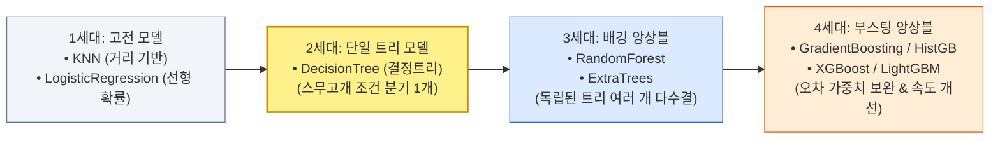
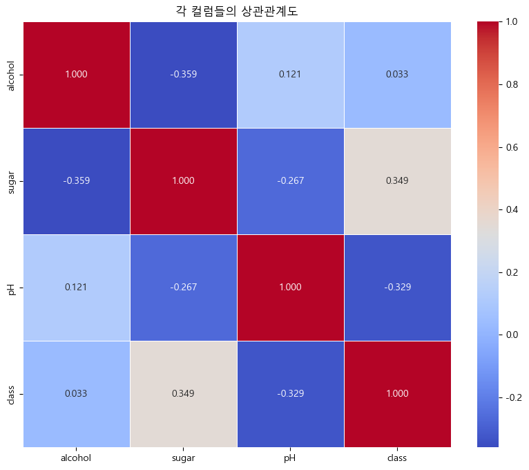
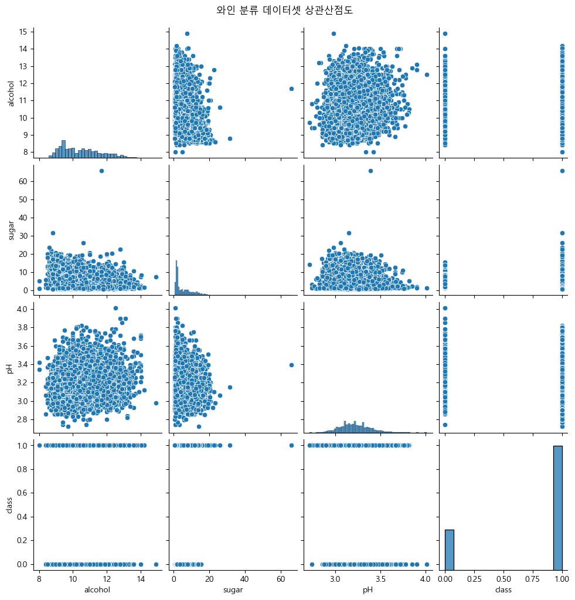
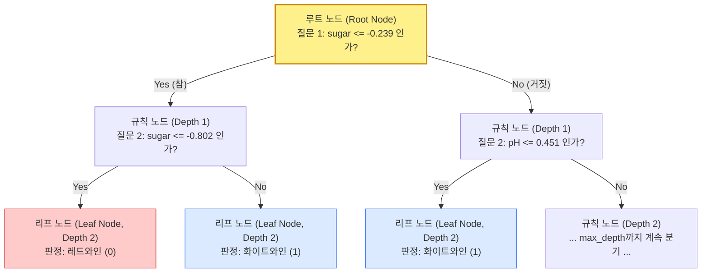
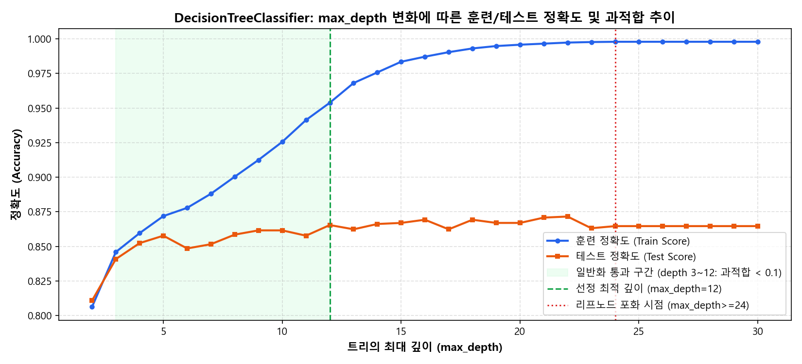
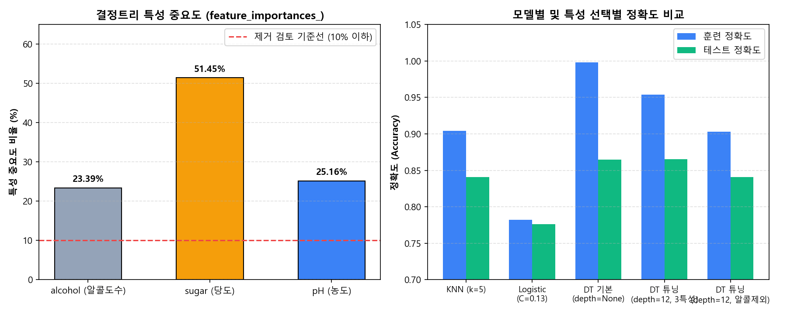

# 🍷 [분류분석(Classification) 기초 및 의사결정나무(Decision Tree) 종합 분석 보고서]

> **분석 대상:** [01_Classifier_DecisionTree_Model.ipynb](file:///d:/pknu_202610/01_Machine_Learning/9day_Classifier_Model_Base/01_Classifier_DecisionTree_Model.ipynb) (Cell 0 ~ Cell 38 전수 코드·주석·출력 포함)  
> **사용 데이터셋:** `08_wine.csv` (총 6,497건 / 레드와인 `0.0`: 1,599건(24.6%), 화이트와인 `1.0`: 4,898건(75.4%))  
> **핵심 목표:** 알콜도수(`alcohol`), 당도(`sugar`), 산도/농도(`pH`) 3가지 화학적 특성을 바탕으로 와인의 종류(`class`: 레드 `0` vs 화이트 `1`)를 판별하는 **이진 분류(Binary Classification)** 전체 파이프라인 구축 및 **결정트리(`DecisionTreeClassifier`) 가지치기(`max_depth`) 튜닝·특성 중요도(`feature_importances_`) 검증**

---

## 📑 목차 (Table of Contents)

1. [핵심 요약 (Executive Summary): 오늘 배운 내용 & 내 주석 핵심 총정리](#1-핵심-요약-executive-summary-오늘-배운-내용--내-주석-핵심-총정리)
2. [Chapter 1: 분류분석(Classification)의 개념과 모델 진화 계보 (Cell 0~2)](#2-chapter-1-분류분석classification의-개념과-모델-진화-계보-cell-02)
   - 1.1 회귀(Regression) vs 분류(Classification) & 이진분류 vs 다중분류
   - 1.2 분류 모델의 4단계 진화 계보와 찰떡 비유
   - 1.3 필수 라이브러리 임포트 코드 및 역할 정리
3. [Chapter 2: 와인 데이터셋(`08_wine.csv`) 탐색 및 클래스 분포 확인 (Cell 3~6)](#3-chapter-2-와인-데이터셋08_winecsv-탐색-및-클래스-분포-확인-cell-36)
   - 2.1 데이터 로드 및 기초통계량(`info`, `describe`) 해석
   - 2.2 종속변수(`class`) 고유값 및 비율(`normalize=True`) 확인
4. [Chapter 3: 상관관계 분석 3단계 시각화 및 통계적 유의성 검정 (Cell 7~13)](#4-chapter-3-상관관계-분석-3단계-시각화-및-통계적-유의성-검정-cell-713)
   - 3.1 상관관계 분석 및 검정 4단계 표준 프로토콜
   - 3.2 1~3단계: 상관계수 행렬(`corr`), 히트맵(`heatmap`), 산점도 행렬(`pairplot`)
   - 3.3 4단계: 스피어만(`spearmanr`) vs 피어슨(`pearsonr`) p-value 유의성 검정 및 차원 확인
   - 3.4 상관관계 분석 종합 해석 (왜 `alcohol`을 바로 버리지 않는가?)
5. [Chapter 4: 계층적 데이터 분할(`stratify`) 및 표준화 스케일링 (Cell 14~17)](#5-chapter-4-계층적-데이터-분할stratify-및-표준화-스케일링-cell-1417)
   - 4.1 8:2 훈련/테스트 분리와 `stratify=target`의 중요성
   - 4.2 `StandardScaler` 표준화 전처리
6. [Chapter 5: 고전 분류 모델(KNN, 로지스틱 회귀) 베이스라인 실험 (Cell 18~22)](#6-chapter-5-고전-분류-모델knn-로지스틱-회귀-베이스라인-실험-cell-1822)
   - 5.1 `KNeighborsClassifier` (KNN 분류 모델) 훈련 및 과적합 점검
   - 5.2 `LogisticRegression` (로지스틱 회귀) 원리, 하이퍼파라메터(`C`, `max_iter`) 및 실험
7. [Chapter 6: 의사결정나무(`DecisionTreeClassifier`) 원리와 가지치기(`max_depth`) 튜닝 (Cell 23~31)](#7-chapter-6-의사결정나무decisiontreeclassifier-원리와-가지치기max_depth-튜닝-cell-2331)
   - 6.1 결정트리(DT)의 작동 원리와 '스무고개' 비유
   - 6.2 기본 결정트리(`max_depth=None`)와 `max_depth=50`의 과대적합 확인
   - 6.3 `max_depth` 2~100 반복 탐색과 **메모리 최적화 주석(`for`문 내부 vs 외부 객체 생성)** 심층 분석
8. [Chapter 7: 특성 중요도(`feature_importances_`) 분석 및 `alcohol` 제거 비교 실험 (Cell 32~38)](#8-chapter-7-특성-중요도feature_importances_-분석-및-alcohol-제거-비교-실험-cell-3238)
   - 7.1 `dt.feature_importances_` 확인 및 해석
   - 7.2 0번째 열(`alcohol`) 슬라이싱 제거(`[:, 1:]`) 및 재훈련 성능 비교 (`image.png` 필기 포함)

---

## 1. 핵심 요약 (Executive Summary): 오늘 배운 내용 & 내 주석 핵심 총정리

> [!IMPORTANT]
> **오늘 실습의 한 줄 핵심 요약:**  
> 와인의 알콜도수·당도·농도 데이터를 가지고 **상관관계 검정(스피어만/피어슨) $\rightarrow$ 계층적 분할(`stratify`) & 표준화 $\rightarrow$ `KNN`·`LogisticRegression`·`DecisionTree` 모델 비교 $\rightarrow$ `max_depth` 가지치기 튜닝 $\rightarrow$ `feature_importances_` 기반 특성 유무 비교 실험**까지 분류분석의 A to Z 표준 절차를 완성했습니다.

### 📌 내가 노트북에 직접 남긴 핵심 주석 & 필기 체크리스트

| 셀 위치 | 내가 작성한 주석 / 메모 원문 | 핵심 원리 및 복습 포인트 |
| :---: | :--- | :--- |
| **Cell 3** | `회귀에서는 예측 = 추정 / 분류에서는 판단` | • **회귀(Regression):** 연속적인 숫자(집값, 길이 등)를 **추정** (`r2_score`)<br>• **분류(Classification):** 정해진 범주(0 또는 1 등) 중 어디에 속하는지 **판단** (`accuracy_score`) |
| **Cell 10** | `# sns.heatmap(corr_matrix, annot=True, cmap="coolwarm", fmt=".3f", linewidths=0.5) 몰랐음`<br>`# alcohol과 class의 상관관계는 매우 낮다`<br>`# alcohol과 pH가 약간 선형인 관계` | • `annot=True`: 칸 안에 숫자 표시 / `cmap="coolwarm"`: 양수(빨강)·음수(파랑) 색상 대비 / `fmt=".3f"`: 소수점 셋째 자리까지 표시 / `linewidths=0.5`: 칸 사이 테두리 여백<br>• `alcohol`과 `class`의 상관계수는 **`0.033`**으로 거의 0에 가까움 |
| **Cell 12** | `target = wine["class"] # 종속변수는 1차원이어야 함.`<br>`# 꼭 차원 확인해보기!!!!!!!` | • 독립변수(`data`)는 **2차원 행렬 `(6497, 3)`**, 종속변수(`target`)는 **1차원 벡터 `(6497,)`** 형태여야 사이킷런 및 통계 검정 함수에서 경고/에러 없이 작동함 |
| **Cell 15** | `### stratify=target : 분리 비율에 맞게 종속변수의 범주값들을 분리` | • 화이트와인(75.4%)과 레드와인(24.6%)처럼 클래스 비율이 불균형할 때, 훈련셋과 테스트셋에도 **동일한 75.4 : 24.6 비율이 유지되도록 계층적 추출** 수행 |
| **Cell 29~30** | `# 클래스 생성/ for 문이 끝날 때까지 99개의 메모리를 차지하고 있어서 메모리 낭비됨.`<br>`# 따라서 전역변수로 클래스를 생성한 후 하나의 메모리 주소만 사용` | • `for`문 밖에서 `dt = DecisionTreeClassifier(random_state=42)`를 **단 1번만 생성**하고, 루프 안에서는 `dt.max_depth = depth`로 속성만 바꿔 `fit()`하면 메모리 재할당 낭비를 막을 수 있음 *(단, 리스트에 `dt` 객체를 그대로 담을 때의 얕은 참조 주의점은 본문 7.3절 참고!)* |
| **Cell 36~38** | `` (**"0번째 alcohol"** 표시)<br>`train_scaled2 = train_scaled[:,1:]`<br>`# 훈련 및 테스트 정확도 떨어짐. 일반화 수준은 향상됨.` | • 2차원 넘파이 배열에서 `[:, 1:]` 슬라이싱으로 **0번 컬럼(`alcohol`)을 제외**하고 1번(`sugar`), 2번(`pH`)만 선택<br>• `alcohol` 제거 시 과적합 격차는 `0.0884 → 0.0624`로 줄어드나, **테스트 정확도가 `86.54% → 84.08%`로 하락**하므로 특성 중요도(`23.39%`)가 입증한 대로 **`alcohol`을 포함해 훈련하는 것이 타당함!** |

---

## 2. Chapter 1: 분류분석(Classification)의 개념과 모델 진화 계보 (Cell 0~2)

### 2.1 회귀(Regression) vs 분류(Classification) & 이진분류 vs 다중분류

> 💡 **찰떡 비유: "저울로 무게 재기(회귀) vs 과일 선별기로 등급 나누기(분류)"**
> - **회귀 분석 (Regression):** 사과의 당도가 몇 브릭스(Brix)인지, 무게가 몇 그램(g)인지 **연속된 숫자 값을 '추정'**하는 저울입니다.
> - **분류 분석 (Classification):** 컨베이어 벨트 위를 지나가는 와인 병이 **'레드와인(0번 상자)'인지 '화이트와인(1번 상자)'인지 딱 떨어지는 정답 라벨(범주)을 '판단'**하여 분류하는 자동 선별기입니다.

- **종속변수(`y`)의 범주 개수에 따른 구분:**
  1. **이진 분류 (Binary Classification):** 종속변수의 범주가 **딱 2개(`0` 또는 `1`, 참/거짓, 레드/화이트, 정상/불량)**인 경우
  2. **다중 분류 (Multi-class Classification):** 종속변수의 범주가 **3개 이상(`0, 1, 2, ...`, 예: 포도 품종 5가지 분류)**인 경우

---

### 2.2 분류 모델의 4단계 진화 계보 (Cell 1)

```python
"""
<분류분석에서 사용되는 모델>
- 옛날 모델 : KNN, LogisticRegression(로지스틱레그레이션, 다중분류모델)


- 그다음 향상 모델 : DecisionTree(DT, 결정트리, 의사결정나무라고 칭함, 트리구조 1개 사용)


- 그다음 향상 모델(최신, 트리구조 1개 이상 사용)
  : RandomForest, ExtraTrees


- 그다음 향상 모델(성능 향상 최신, 훈련 중 데이터 섞기 방법 및 속도 개선)
  : GradientBoosting, HistGradientBoosting, XGBoost, LightGBM, 기타 등등


 - 상관관계 검정부터 분류 평가까지 모두 진행...
"""
```



---

### 2.3 필수 라이브러리 임포트 코드 및 역할 정리 (Cell 2)

```python
### 사용할 라이브러리 불러들이기

# 데이터 조작을 위한 라이브러리
import pandas as pd

# 기본 시각화 라이브러리
import matplotlib.pyplot as plt

# 통계적 시각화 라이브러리(보통 기본 시각화보다 향상된 라이브러리라고 생각하면 됨)
import seaborn as sns

# 시각화 시 그래프의 너비/높이 기본 설정하기(단위=인치)
plt.rcParams["figure.figsize"] = (12, 5)

# 시각화시 한글 깨짐 처리를 위한 폰트 지정(Window OS 기준, Mac OS나 Linux는 그에 맞게)
plt.rcParams['font.family'] = 'Malgun Gothic'

# 시각화시 마이너스(-) 기호 깨짐 방지 처리
plt.rcParams['axes.unicode_minus'] = False

### 상관관계 검정()
from scipy.stats import spearmanr, pearsonr

### 훈련/검증/테스트 데이터로 분리하는 함수
from sklearn.model_selection import train_test_split

### 데이터 스케일링 표준화 클래스
from sklearn.preprocessing import StandardScaler

### 사용할 훈련모델 클래스
from sklearn.neighbors import KNeighborsClassifier
from sklearn.linear_model import LogisticRegression
from sklearn.tree import DecisionTreeClassifier

### 분류분석 오차 확인(평가) 라이브러리
# - 오차행렬표, 오차행렬도(그래프)
from sklearn.metrics import confusion_matrix, ConfusionMatrixDisplay

### 분류모델 평가지표(선정기준)
# - 정확도, 정밀도, 재현율, f1-score
from sklearn.metrics import accuracy_score, precision_score, recall_score, f1_score
```

> [!NOTE]
> **회귀(Regression)와 달라진 라이브러리 포인트:**
> - 모델 클래스 이름 뒤에 `Regressor` 대신 **`Classifier` (`KNeighborsClassifier`, `DecisionTreeClassifier`)**가 붙습니다. (단, `LogisticRegression`은 이름에 Regression이 들어가지만 **분류 전용 모델**입니다!)
> - 평가지표 역시 `MAE`, `MSE`, `r2_score` 대신 **오차행렬(`confusion_matrix`)**과 **정확도(`accuracy_score`), 정밀도(`precision_score`), 재현율(`recall_score`), 조화평균(`f1_score`)**을 사용합니다.

---

## 3. Chapter 2: 와인 데이터셋(`08_wine.csv`) 탐색 및 클래스 분포 확인 (Cell 3~6)

### 3.1 데이터 로드 및 기초통계량(`info`, `describe`) 해석 (Cell 3)

```python
### 사용할 데이터셋 : 08_wine.csv
# 사용할 변수명 : wine
# 데이터 기본정보 및 기초통계 확인

file_path = "./dataset/08_wine.csv"
wine = pd.read_csv(file_path)
wine.info()
wine.describe()
### (각 특성의 개념)
# - alcohol : 알콜도수
# - sugar : 당도
# - pH : 농도
# - class : 와인종류(0은 레드와인, 1은 화이트와인)

### (분석주제)
# - 알콜도수, 당도, 농도 데이터를 이용하여 와인종류 예측(판단=분류)하기 (회귀에서는 예측 = 추정/ 분류에서는 판단)

### (분류 분석 방법)
# - 예측(분류=판단)하고자하는 변수(종속변수)의 범주 갯수에 따라 분류 방법을 결정함
# - 분류 분석 방법에는 이진분류와 다중분류 방법이 있음(딥러닝에서도 사용되는 개념)
# - 이진분류 : 종속변수의 범주의 갯수가 2개(0 또는 1)인 경우
# - 다중분류 : 종속변수의 범주의 갯수가 3개 이상(0, 1, 2, ...)인 경우

### (데이터 정의)
# - 독립변수(X) : 알콜도수(alcohol), 당도(sugar), 농도(pH)
# - 종속변수(y) : 와인종류(class)
```

#### 📊 실행 결과 (`wine.info()` & `wine.describe()`)

| 통계량 | `alcohol` (알콜도수, 독립 X) | `sugar` (당도, 독립 X) | `pH` (농도/산도, 독립 X) | `class` (와인종류, 종속 y) |
| :---: | :---: | :---: | :---: | :---: |
| **데이터 수 (`count`)** | `6,497` (결측치 없음) | `6,497` (결측치 없음) | `6,497` (결측치 없음) | `6,497` (결측치 없음) |
| **평균 (`mean`)** | `10.4918` | `5.4432` | `3.2185` | `0.7539` |
| **표준편차 (`std`)** | `1.1927` | `4.7578` | `0.1608` | `0.4308` |
| **최솟값 (`min`)** | `8.0000` | `0.6000` | `2.7200` | `0.0000` (레드와인) |
| **중앙값 (`50%`)** | `10.3000` | `3.0000` | `3.2100` | `1.0000` (화이트와인) |
| **최댓값 (`max`)** | `14.9000` | `65.8000` | `4.0100` | `1.0000` (화이트와인) |

- **스케일(단위) 불균형 발견:** `pH`는 `2.72 ~ 4.01`의 아주 좁은 범위에서 움직이는 반면, `sugar`(당도)는 `0.60 ~ 65.80`까지 값의 폭이 매우 큽니다. 따라서 거리 기반 모델(`KNN`)이나 경사하강법 기반 모델(`LogisticRegression`)에 넣기 전에 **`StandardScaler` 표준화 스케일링이 필수적**임을 알 수 있습니다.

---

### 3.2 종속변수(`class`) 고유값 및 비율(`normalize=True`) 확인 (Cell 4~6)

```python
### 와인의 종류 확인 (Cell 5)
wine.value_counts("class")
wine["class"].value_counts()

# 컬럼 내 값들 중에 고유한 값들만 추출(중복 제거)
wine["class"].unique()
# 출력: array([0., 1.])
### 0과 1의 범주 2개만 존재하는 이진분류가 가능한 데이터...
```

```python
### 범주 비율(Proportion) 확인 (Cell 6)
wine.value_counts("class", normalize=True)
```

```text
class
1.0    0.753886
0.0    0.246114
Name: proportion, dtype: float64
```

- **해석:**
  - `wine["class"].unique()` 결과가 `[0., 1.]`이므로 **이진 분류(Binary Classification)** 문제입니다.
  - `normalize=True` 옵션을 주면 개수가 아닌 **전체 대비 비율(확률)**로 변환해 보여줍니다. 화이트와인(`1.0`)이 **약 75.4%**, 레드와인(`0.0`)이 **약 24.6%**로 화이트와인 데이터가 약 3배 더 많이 들어 있는 **클래스 불균형(Imbalanced Class)** 상태입니다.

---

## 4. Chapter 3: 상관관계 분석 3단계 시각화 및 통계적 유의성 검정 (Cell 7~13)

### 4.1 상관관계 분석 및 검정 4단계 표준 프로토콜 (Cell 8)

```python
### 상관관계 계수 확인하기
# - 상관관계 확인시에는 독립변수 및 종속변수로 나누지 않고 합니다.
# - 상관관계 검정시에는 독립변수와 종속변수로 구분해야함


### <상관관계 분석 및 검증 순서>
# 1. 상관관계 메트릭스표 확인(상관관계 계수 확인)
#   -> *데이터프레임.corr() 후 변수 담기 corr_matrix
# 2. 상관관계도 시각화(히트맵-상관관계 계수를 색으로 확인)
#   -> sns.heatmap
# 3. 상관행렬도 시각화(산점도 분포 확인-선형/비선형 형태 확인)
#   -> sns.pairplot

# 4. 상관관계 검정
#    : 종속변수와 독립변수 각각에 대한 유의미성 확인
#    : 독립과 종속변수 각각 구분하여 진행
#      (독립변수 변수명 : data, 종속변수 변수명 : target)
#   -> data = wine에서 class를 drop / target은 wine에서 ["class"]만 담기
#    : 검정방법 (스피어만, 피어슨 방법 사용). p-value 기준 0.05
#   -> spearmanr(독립변수, 종속변수), pearsonr(독립변수, 종속변수)
```

---

### 4.2 1~3단계: 상관계수 행렬(`corr`), 히트맵(`heatmap`), 산점도 행렬(`pairplot`) (Cell 10)

```python
# 1.상관관계 메트릭스표 확인
corr_matrix=wine.corr()
corr_matrix

# 2. 상관관계도 시각화(히트맵-상관관계 계수를 색으로 확인)
plt.figure(figsize=(10,8))
plt.title("각 컬럼들의 상관관계도")
sns.heatmap(corr_matrix, annot=True, cmap="coolwarm", fmt=".3f", linewidths=0.5)
# sns.heatmap(corr_matrix, annot=True, cmap="coolwarm", fmt=".3f", linewidths=0.5) 몰랐음
# alcohol과 class의 상관관계는 매우 낮다

# 3. 상관행렬도 시각화
sns.pairplot(wine)
plt.suptitle("와인 분류 데이터셋 상관산점도", y=1.02)
plt.show()
# alcohol과 pH가 약간 선형인 관계
```

#### 📊 `sns.heatmap` 각 옵션 완벽 해부 (내가 *"몰랐음"*이라고 적어둔 부분!)

| 인자(Parameter) | 작성한 코드 값 | 역할 및 설명 |
| :---: | :--- | :--- |
| **첫 번째 인자** | `corr_matrix` | `wine.corr()`로 구한 $4 \times 4$ 상관계수 데이터프레임 전달 |
| **`annot`** | `annot=True` | **Annotation(주석 표시):** 히트맵 각 격자 칸 안에 실제 상관계수 숫자를 글씨로 적어줌 (`False`면 색깔만 나옴) |
| **`cmap`** | `cmap="coolwarm"` | **Color Map(색상 테마):** 양의 상관관계($+1$ 근처)는 따뜻한 **빨간색(Warm)**, 음의 상관관계($-1$ 근처)는 차가운 **파란색(Cool)**으로 직관적 대비 표현 |
| **`fmt`** | `fmt=".3f"` | **Format(숫자 서식):** 칸 안에 적히는 숫자를 **소수점 셋째 자리(`.3f`)**까지 반올림하여 깔끔하게 출력 |
| **`linewidths`** | `linewidths=0.5` | 각 사각형 셀 사이의 구분선(흰색 테두리) 두께를 `0.5`로 주어 칸들이 서로 뭉개지지 않게 구분 |

````carousel

<!-- slide -->

````

#### 🔍 시각화로 읽는 데이터 특징
1. **히트맵(`heatmap`) 확인:** 종속변수 `class`와의 상관계수는 **`sugar` (`+0.349`) > `pH` (`-0.329`) > `alcohol` (`+0.033`)** 순입니다. 즉, 화이트와인(`1`)일수록 당도가 높고(`+`) pH 농도는 낮은(`-`) 경향이 뚜렷하지만, **알콜도수(`0.033`)는 단순 선형 상관계수가 거의 0에 가깝습니다.**
2. **산점도 행렬(`pairplot`) 확인:** `class` 행/열의 점 분포를 보면, 회귀 데이터처럼 대각선으로 비스듬히 올라가는 모양이 아니라 **`0.0`과 `1.0` 두 층에 수평(또는 수직)으로 나란히 줄지어 모이는 형태**를 띱니다. 따라서 선형 회귀가 아닌 **분류 분석(Classification)**으로 접근하는 것이 100% 타당합니다!

---

### 4.3 4단계: 스피어만(`spearmanr`) vs 피어슨(`pearsonr`) 유의성 검정 (Cell 12)

> 💡 **찰떡 비유: "피어슨은 '자(Ruler)로 잰 직선 비례' 검사관, 스피어만은 '등수(Rank)로 매긴 추세' 검사관"**
> - **피어슨 상관계수 (`pearsonr`):** 두 변수가 **일정한 기울기의 직선(선형 관계)**으로 비례하는지 검사합니다.
> - **스피어만 상관계수 (`spearmanr`):** 실제 값 대신 데이터의 **순위(등수)**를 매겨 비교하므로, 직선이 아니더라도 **곡선(비선형 단조 관계)이나 범주형/이상치가 섞인 실제 현장 데이터**까지 폭넓게 잡아내는 실무 표준 검정법입니다.
> - **유의확률 (`p-value < 0.05`):** *"이 상관관계가 우연히 나왔을 확률이 5% 미만인가?"* $\rightarrow$ **`p < 0.05`이면 통계적으로 유의미함(관계 있음!)**, **`p >= 0.05`이면 유의미하지 않음(우연일 수 있음)**.

```python
# 4. 상관관계 검정
#    : 종속변수와 독립변수 각각에 대한 유의미성 확인
#    : 독립과 종속변수 각각 구분하여 진행
#      (독립변수 변수명 : data, 종속변수 변수명 : target)
data = wine.drop(columns=["class"])
data = wine.iloc[:,:-1]
data
target = wine["class"] # 종속변수는 1차원이어야 함.
target
# 꼭 차원 확인해보기!!!!!!!
data.shape, target.shape   # ((6497, 3), (6497,))

print("============================================spearman방식==============================================")
for col in data.columns:
    s, p = spearmanr(data[col], target)
    if p < 0.05:
        print(f"{col}과 class와의 스피어만 검정해보았을 때, \n유의미 계수는 {p:.4f}로 p-value < 0.05 유의미함")
    if p >= 0.05:
        print(f"{col}과 class와의 스피어만을 검정해보았을 때, \n유의미 계수는 {p:.4f}로 p-value >= 0.05 유의미하지 않음")

print("=============================================pearson방식================================================")
for col in data.columns:
    s, p = pearsonr(data[col], target)
    if p < 0.05:
        print(f"{col}과 class와의 피어슨 검정해보았을 때, \n유의미 계수는 {p:.4f} 로 p-value < 0.05 유의미함")
    if p >= 0.05:
        print(f"{col}과 class와의 피어슨 검정해보았을 때, \n유의미 계수는 {p:.4f}로 p-value >= 0.05 유의미하지 않음")
```

#### 📊 검정 결과 비교표

| 독립변수 특성 | 스피어만 검정 (`spearmanr`) p-value | 스피어만 판정 (`p < 0.05`) | 피어슨 검정 (`pearsonr`) p-value | 피어슨 판정 (`p < 0.05`) |
| :---: | :---: | :---: | :---: | :---: |
| **`alcohol` (알콜도수)** | `0.1819` | ❌ **유의미하지 않음 (`>= 0.05`)** | `0.0079` | ✅ **유의미함 (`< 0.05`)** |
| **`sugar` (당도)** | `0.0000` | ✅ **유의미함 (`< 0.05`)** | `0.0000` | ✅ **유의미함 (`< 0.05`)** |
| **`pH` (농도)** | `0.0000` | ✅ **유의미함 (`< 0.05`)** | `0.0000` | ✅ **유의미함 (`< 0.05`)** |

---

### 4.4 상관관계 분석 종합 해석 (Cell 13)

```python
### (종합 해석)
# - 상관관계 계수의 경우 알콜의 계수값은 0.03으로 매우 낮은 상관성을 띄고 있으며,
#   -> 당도 및 농도의 경우에는 0.3 이상으로 낮지만 상관성을 띄고 있음
#   -> 알콜의 경우 향후 모델 훈련 시 제외하고 진행하여,
#      성능에 영향을 미치는지도 확인할 필요성이 있음

# - 전체 특성들의 분포를 볼 때,
#   -> 와인종류의 0과 1을 기준으로 `수평` 분포를 나타내고 있기에
#   -> 분류 분석으로 진행하는 것이 타당함

### (해석)
# - 실제 문서에 작성할 때는 한가지 방법으로만 작성
# - 하지만, 분석가 입장에서는 모두다 확인 후 최종 훈련이 완료된 다음에 결정

### 선형/비선형 모두 가능한 검정방식인 스피어만 검정 방법에서는(현장에서 주로 스피어만 방식)
#   - 알콜의 경우 p-value >= 0.05 이므로, 유의미하지 않았으며,
#   - 당도 및 농도의 경우 p-value < 0.05를 만족하여 유의미한 것으로 확인됨

### 선형을 주로 검정하는 피어슨 검정 방법에서는(선형 측정)
#   - 모든 특성들이 p-value < 0.05를 만족하여 유의미하므로, 모두 훈련에 사용가능

### 따라서, 이론상으로는 스피어만 방식을 준수해야하나,
#   모델 훈련 시에는 모든 특성을 적용하여 훈련 후,
#   유의미하지 않은 알콜을 제외하고, 재훈련하여 비교할 필요성은 있음
```

> [!TIP]
> **실무 데이터 분석가의 의사결정 노하우:**  
> 스피어만 검정에서 `alcohol`의 p-value가 `0.1819`로 나왔다고 해서 **모델을 돌려보지도 않고 처음부터 칼같이 삭제하면 안 됩니다!** 단독으로는 상관성이 낮아 보여도, 트리 모델 안에서 **`sugar`(당도) 및 `pH`(농도)와 결합(상호작용)될 때 중요한 분기 조건으로 쓰일 수 있기 때문**입니다. 따라서 **"1차로 모든 특성을 넣어 훈련 및 특성 중요도를 확인한 뒤, 2차로 `alcohol`을 뺀 모델과 성능을 직접 비교하여 최종 결정"**하는 것이 정석입니다. (실제로 Chapter 7에서 이 실험을 수행합니다!)

---

## 5. Chapter 4: 계층적 데이터 분할(`stratify`) 및 표준화 스케일링 (Cell 14~17)

### 5.1 8:2 훈련/테스트 분리와 `stratify=target`의 중요성 (Cell 15)

```python
"""
변수명 :train_input, train_target, test_input, test_target
"""

### stratify=target : 분리 비율에 맞게 종속변수의 범주값들을 분리
train_input, test_input, train_target, test_target = train_test_split(
    data, target, test_size=0.2, stratify=target, random_state=42
)
print(train_input.shape, train_target.shape)
print(test_input.shape, test_target.shape)
```

```text
(5197, 3) (5197,)
(1300, 3) (1300,)
```

> 💡 **찰떡 비유: "국자 밑바닥까지 골고루 저어서 건더기와 국물 비율 맞춰 뜨기 (`stratify=target`)"**
> - 전체 냄비(`wine`)에 화이트와인 건더기가 75%, 레드와인 건더기가 25% 들어 있습니다.
> - 그냥 무작위로 국자를 뜨면, 자칫 훈련 데이터에 화이트와인만 90%가 몰릴 수 있습니다.
> - **`stratify=target`** 옵션을 주면, 훈련셋(5,197개)과 테스트셋(1,300개) 모두 정확히 **화이트와인 75.4% : 레드와인 24.6%의 황금 비율을 똑같이 유지**하도록 나누어 줍니다. **분류 분석에서는 필수 옵션**입니다!

---

### 5.2 `StandardScaler` 표준화 전처리 (Cell 17)

```python
### StandardScaler로 스케일링 처리하기
# 변수명 : ss
# 훈련 및 테스트 스케일링 변수명 : train_scaled, test_scaled
# 클래스 생성
ss = StandardScaler()
# 패턴찾기 (반드시 훈련 데이터로만 fit!)
ss.fit(train_input)
# 변환시키기
train_scaled = ss.transform(train_input)
test_scaled = ss.transform(test_input)

print(train_scaled.shape, train_target.shape)
print(test_scaled.shape, test_target.shape)
```

- **주의할 점:** 스케일러의 평균과 표준편차 기준(`ss.fit`)은 **오직 훈련 데이터(`train_input`)로만 계산**해야 하며, 테스트 데이터(`test_input`)는 훈련 데이터의 기준으로 변환(`ss.transform`)만 해야 데이터 누수(Data Leakage)를 막을 수 있습니다.

---

## 6. Chapter 5: 고전 분류 모델(KNN, 로지스틱 회귀) 베이스라인 실험 (Cell 18~22)

### 6.1 `KNeighborsClassifier` (KNN 분류 모델) 훈련 및 과적합 점검 (Cell 19)

```python
### KNN 분류 모델로 과적합만 확인하기
# - 이웃의 갯수는 5개 사용 (기본값 n_neighbors=5)
# 클래스생성
knr = KNeighborsClassifier()
# 훈련시키기
knr.fit(train_scaled, train_target)
### 분류분석에서는 정확도(score)라는 용어를 사용함
train_score = knr.score(train_scaled, train_target)
test_score = knr.score(test_scaled, test_target)
print(f"훈련정확도:{train_score:.4f}, 테스트정확도:{test_score: .4f}")
# 과적합 여부
print(train_score-test_score)
## 해석
# - 과적합 아니고 일반화 잘 되었음.
# - score() 함수의 결과값은 정확도로 확률(%)을 의미함(0 ~ 1 => 0% ~ 100%를 의미함)
```

- **실행 결과:**
  - **훈련 정확도:** `0.9042` (90.42%)
  - **테스트 정확도:** `0.8408` (84.08%)
  - **과적합 여부(`훈련 - 테스트`):** `0.0634` (`0.1` 미만이므로 과적합 없이 일반화 양호)
- **원리 요약:** 새로운 와인 데이터 주변에서 거리가 가장 가까운 이웃 5개(`n_neighbors=5`)를 찾아, 그중 레드와인이 많은지 화이트와인이 많은지 **다수결**로 판단하는 직관적인 모델입니다.

---

### 6.2 `LogisticRegression` (로지스틱 회귀) 원리 및 실험 (Cell 21~22)

```python
"""
<로지스틱 레그레이션 모델>
 - 이름은 회귀이지만, 분류분석에 사용되는 모델 입니다.
 - 내부적으로 사용되는 산술식이 "다중회귀" 모델의 알고리즘을 사용
 - 이진분류, 다중분류에 사용됩니다.

<로지스틱레그레이션 모델 성능 향상을 위한 하이퍼파라메터 튜닝>
 - 튜닝에 사용되는 기본적인 변수명 : C(규제강도), max_iter(훈련 반복횟수)
 - C(규제강도)
   : 규제강도는 릿지 또는 라쏘에서 사용한 alpha 규제강도와 동일한 개념으로
     복잡도를 높이거나 낮추는 방식을 적용함
   : C의 기본값은 = 1
   : C 값의 범위 : 0.001~100 사이를 주로 사용
   : C의 값이 커질수록 규제를 완화시키며, 작을수록 규제를 강화시킴
   
 - max_iter(훈련 반복횟수)
   : 훈련을 여러번 반복하여 훈련의 정확도를 높임
   : max_iter의 기본값은 = 100
   : max_iter의 범위 : 1이상~
   
***(중요) 하이퍼파라메터 튜닝을 한다고 해서 꼭~ 모델의 성능이 좋아진다고 볼수는 없음
          오히려 나빠지는 경우도 가끔 발생함
"""
```

> 💡 **찰떡 비유: "다중회귀 계산기에 확률 변환 깔때기(시그모이드)를 끼운 판독기"**
> - 왜 분류 모델인데 이름에 **회귀(`Regression`)**가 붙었을까요? 내부적으로 다중선형회귀 공식($z = w_1 \times \text{alcohol} + w_2 \times \text{sugar} + w_3 \times \text{pH} + b$)을 그대로 계산한 뒤, 그 결과를 **0% ~ 100%(0.0 ~ 1.0) 사이의 확률로 압축**해 주기 때문입니다. 확률이 `0.5`(50%)보다 크면 화이트와인(`1`), 작으면 레드와인(`0`)으로 분류합니다!
> - ⚠️ **규제 강도 `C` 주의점 (Ridge/Lasso의 `alpha`와 정반대 방향!):**
>   - `Ridge`/`Lasso`의 `alpha`: 값이 **작을수록** 규제 완화, **클수록** 규제 강화
>   - `LogisticRegression`의 `C`: $C = \frac{1}{\alpha}$ (역수 개념)이므로, **`C`가 작을수록(`0.13`) 규제가 강해지고, `C`가 클수록 규제가 완화**됩니다!

```python
### 로지스틱레그레이션으로 훈련 후 과적합 여부 확인까지만 진행 (Cell 22)
# - 규제강도=0.13, 반복횟수=100회(기본값)
lr = LogisticRegression(C=0.13)
lr.fit(train_scaled, train_target)

train_score = lr.score(train_scaled, train_target)
test_score = lr.score(test_scaled, test_target)
print(f"훈련정확도는{train_score:.5f}, 테스트정확도는{test_score:.5f}입니다. \n과적합여부:{train_score-test_score:.5f}")
### 훈련 정확도는 낮지만, 일반화는 잘 되었음
```

- **실행 결과:**
  - **훈련 정확도:** `0.78218` (78.22%) / **테스트 정확도:** `0.77615` (77.62%) / **과적합 여부:** `0.00603`
  - **해석:** 일반화는 매우 안정적이지만, 와인 데이터의 비선형적인 경계를 직선 방정식 하나로만 나누려다 보니 정확도가 **77~78% 수준에 머무르는 한계(과소적합 경향)**를 보입니다. 이를 극복하기 위해 등장한 것이 바로 **결정트리(Decision Tree)**입니다!

---

## 7. Chapter 6: 의사결정나무(`DecisionTreeClassifier`) 원리와 가지치기(`max_depth`) 튜닝 (Cell 23~31)

### 7.1 결정트리(DT)의 작동 원리와 '스무고개' 비유 (Cell 24 & Cell 27)

> 💡 **찰떡 비유: "예/아니오 질문을 던져 정답을 좁혀 가는 스무고개 게임"**
> - 결정트리(`DecisionTreeClassifier`)는 데이터를 한 번에 수학 공식에 넣는 대신, **"1번 질문: 당도(`sugar`)가 -0.2보다 작은가? (Yes/No)" $\rightarrow$ "2번 질문: 알콜도수가 0.5보다 높은가? (Yes/No)"**처럼 스무고개 질문을 연속으로 던져 가지를 뻗어 나갑니다.
> - **핵심 용어 3가지:**
>   1. **루트 노드 (Root Node):** 맨 꼭대기에서 첫 번째 질문을 시작하는 뿌리 마디 (깊이 `0`에서 시작)
>   2. **규칙 노드 (Decision/Internal Node):** 아직 와인 종류가 하나로 확정되지 않아 다음 질문으로 가지를 뻗는 중간 마디
>   3. **리프 노드 (Leaf Node):** 더 이상 질문을 던지지 않고 **"이건 화이트와인이다!"라고 종속변수가 최종 결정되는 끝단 잎사귀 마디**
> - **가지치기 깊이 (`max_depth`):** 루트 노드 바로 아래 층(1층)부터 시작해 **최대 몇 번까지 스무고개 질문을 내려갈지 제한**하는 하이퍼파라메터입니다. 만약 제한 횟수(`max_depth`)에 도달하기 전이라도 한쪽 바구니에 레드와인만 100% 남게 되면(불순도 0), 그 즉시 리프 노드로 확정 짓고 가지 뻗기를 자동 종료합니다!



---

### 7.2 기본 결정트리(`max_depth=None`)와 `max_depth=50`의 과대적합 확인 (Cell 25 & Cell 28)

```python
### 1) 기본 결정트리 모델 (max_depth=None 무제한) (Cell 25)
dt = DecisionTreeClassifier(random_state=42)
dt.fit(train_scaled, train_target)
train_score = dt.score(train_scaled, train_target)
test_score = dt.score(test_scaled, test_target)
print(f"훈련정확도는{train_score:.5f}, 테스트 정확도는{test_score:.5f}입니다. 과적합 여부는{train_score-test_score}")
# 출력: 훈련정확도는0.99788, 테스트 정확도는0.86462입니다. 과적합 여부는0.1332680096505381

### 2) max_depth=50 설정 모델 (Cell 28)
dt = DecisionTreeClassifier(random_state=42, max_depth=50)
dt.fit(train_scaled, train_target)
# 출력: 훈련정확도는0.99788, 테스트 정확도는0.86462입니다. 과적합 여부는0.13327
```

- **왜 기본 모델(`max_depth=None`)과 `max_depth=50`의 점수가 소수점 끝자리까지 똑같을까?**
  - 본 와인 훈련 데이터(5,197건)는 트리가 **깊이 `24`층(`max_depth=24`)**까지만 내려가면 모든 리프 노드의 결정이 완료되어 더 이상 가지를 뻗지 않고 자동 종료됩니다!
  - 따라서 `max_depth=50`이나 `100`을 주더라도 실제로는 `24`층에서 멈추기 때문에 결과가 동일하며, 훈련 데이터를 `99.79%`까지 통째로 암기해 버려 **과적합 격차가 `0.1333` (`> 0.1` 기준 초과)인 전형적인 과대적합(Overfitting)** 상태에 빠집니다.

---

### 7.3 `max_depth` 2~100 반복 탐색 및 메모리 최적화 주석 심층 분석 (Cell 29~31)



#### 📌 내가 주석으로 정리한 메모리 최적화 포인트 비교 (Cell 29 vs Cell 30)

```python
### [Cell 29 방식] for문 안에서 매번 객체를 새로 생성하는 방식
for depth in range(2, 101, 1):
    # 클래스 생성 / for 문이 끝날 때까지 99개의 메모리를 차지하고 있어서 메모리 낭비됨.
    dt = DecisionTreeClassifier(random_state=42, max_depth=depth)
    dt.fit(train_scaled, train_target)
```

```python
### [Cell 30 방식] for문 밖에서 객체를 1번만 생성하고 속성만 변경하는 메모리 절약 방식
### for 문 내에서 클래스를 생성하면 반복 횟수만큼 클래스가 생성되어 메모리를 낭비함.
# - 따라서 전역변수로 클래스를 생성한 후 하나의 메모리 주소만 사용
# - for문 내에서는 클래스 메모리 내에 있는 트리깊이 변수의 값만 수정하면서 훈련(fit)을 반복하면
# -> 메모리를 낭비하지 않을 수 있음
dt = DecisionTreeClassifier(random_state=42)
model = "model"
model_list = []
for depth in range(2, 101, 1):
    # 트리깊이 변수의 값만 수정하면서 훈련(fit)을 반복
    dt.max_depth = depth
    # 훈련
    dt.fit(train_scaled, train_target)
    # 정확도
    train_score = dt.score(train_scaled, train_target)
    test_score = dt.score(test_scaled, test_target)
    # 과적합 여부
    print(f"훈련정확도는{train_score:.5f}, 테스트 정확도는{test_score:.5f}입니다. 과적합 여부는{train_score-test_score:.5f}")
    if (train_score != 1) and (train_score > test_score) and ((train_score - test_score) < 0.1):
        model_list.append({model : [
            dt, 
            (f"훈련정확도: {train_score}"), 
            (f"테스트정확도: {test_score}"), 
            (f"과적합여부: {train_score-test_score}")]
        })
```

> [!WARNING]
> **💡 꼭 알아두어야 할 파이썬 메모리 참조(Reference) 디테일 (왜 Cell 31의 `model_list` 출력에서 모든 `dt`가 `max_depth=100`으로 찍혔을까?):**
> - Cell 30처럼 `dt` 객체를 `for`문 밖에서 **단 하나만** 만들어 메모리 주소를 재사용하면, 루프가 돌면서 `dt.max_depth`를 `2 → 3 → ... → 100`으로 계속 덮어씁니다.
> - 이때 `model_list.append({model: [dt, ...]})`에 들어간 `dt`는 **모두 똑같은 하나의 메모리 주소**를 가리키고 있기 때문에, 루프가 `depth=100`으로 끝난 뒤 Cell 31에서 `model_list`를 출력해 보면 **리스트 안의 모든 `dt` 객체가 마지막 값인 `DecisionTreeClassifier(max_depth=100, random_state=42)`로 바뀌어 보이게 됩니다!** (단, 문자열로 저장한 `'훈련정확도: ...'`, `'테스트정확도: ...'`는 각 `depth=3~12` 당시의 점수가 그대로 잘 남아 있습니다.)
> - 만약 메모리를 아끼면서도 조건(`과적합 < 0.1`)을 통과한 10개 모델만 독립된 객체로 보관하고 싶다면, `if`문 안쪽에서 `copy.deepcopy(dt)`를 넣거나 기록용 튜닝 시에는 `depth` 숫자만 저장한 뒤 **최종 선정된 `max_depth=12`로 단 한 번만 모델을 새로 생성(Cell 38 방식)**하면 가장 깔끔합니다!

#### 📊 일반화 조건(`train > test` 이면서 `과적합 < 0.1`)을 통과한 `max_depth` 구간 성적표 (Cell 31)

| 트리 깊이 (`max_depth`) | 훈련 정확도 (`train_score`) | 테스트 정확도 (`test_score`) | 과적합 격차 (`train - test`) | 판정 및 해석 |
| :---: | :---: | :---: | :---: | :--- |
| `depth = 2` | `0.80623` (80.62%) | `0.81077` (81.08%) | `-0.00453` | 음수(`훈련 < 테스트`)로 **과소적합** 제외 |
| `depth = 3` | `0.84587` (84.59%) | `0.84077` (84.08%) | `0.00510` | 일반화 통과 (`model_list[0]`) |
| `depth = 4` | `0.85953` (85.95%) | `0.85231` (85.23%) | `0.00723` | 일반화 통과 (`model_list[1]`) |
| `depth = 5` | `0.87185` (87.18%) | `0.85769` (85.77%) | `0.01416` | 일반화 통과 (`model_list[2]`) |
| `depth = 6` | `0.87781` (87.78%) | `0.84846` (84.85%) | `0.02935` | 일반화 통과 (`model_list[3]`) |
| `depth = 7` | `0.88801` (88.80%) | `0.85154` (85.15%) | `0.03647` | 일반화 통과 (`model_list[4]`) |
| `depth = 8` | `0.90033` (90.03%) | `0.85846` (85.85%) | `0.04187` | 일반화 통과 (`model_list[5]`) |
| `depth = 9` | `0.91245` (91.24%) | `0.86154` (86.15%) | `0.05091` | 일반화 통과 (`model_list[6]`) |
| `depth = 10` | `0.92553` (92.55%) | `0.86154` (86.15%) | `0.06400` | 일반화 통과 (`model_list[7]`) |
| `depth = 11` | `0.94131` (94.13%) | `0.85769` (85.77%) | `0.08362` | 일반화 통과 (`model_list[8]`) |
| **`depth = 12` ★** | **`0.95382` (95.38%)** | **`0.86538` (86.54%)** | **`0.08843`** | **최적 선정 지점 (`model_list[9]`): 과적합 `< 0.1` 마지노선 안에서 훈련·테스트 정확도 모두 최고점!** |
| `depth = 13~` | `0.96806 ~ 0.99788` | `0.86231 ~ 0.86462` | `0.10575 ~ 0.13327` | 과적합 격차가 `0.1`을 초과하여 **과대적합** 탈락 |

---

## 8. Chapter 7: 특성 중요도(`feature_importances_`) 분석 및 `alcohol` 제거 비교 실험 (Cell 32~38)

### 8.1 `dt.feature_importances_` 확인 및 해석 (Cell 33~34)

```python
"""
<특성 중요도(feature importances)>
 - 훈련에 사용된 독립변수의 특성들이
 - 종속변수를 찾는데 얼마나 영향을 미쳤는지를 확인하여
 - 특성이 미친 영향을 비율(%)로 나타냅니다.
 - 일부 모델들은 특성 중요도 값을 제공하지 않는 모델도 있음
 - 특성 중요도는 분류모델에서 사용됨 (트리 기반 모델에서 모두 제공)
"""

### 특성 중요도 확인하기(영향을 미치는 정도)
# - alcohol, sugar, pH 순서
print(dt.feature_importances_)
# 출력: [0.23393909 0.51450301 0.2515579 ]
```



#### 📊 각 특성별 중요도 비율 정리 (`합계 = 1.0000 = 100%`)

| 컬럼 인덱스 | 특성명 | 상관계수 (`corr`) | 스피어만 p-value | **결정트리 특성 중요도 (`feature_importances_`)** | 분석가 종합 판단 |
| :---: | :---: | :---: | :---: | :---: | :--- |
| **0번째 열** | **`alcohol` (알콜도수)** | `0.0330` (매우 낮음) | `0.1819` (유의미 X) | **`0.2339` (23.39%)** | 상관계수는 낮았으나, 트리 분기 시 **23.4%의 높은 기여도**를 발휘하므로 **제거하지 않고 유지해야 함!** |
| **1번째 열** | **`sugar` (당도)** | `0.3488` | `0.0000` (유의미 O) | **`0.5145` (51.45%)** | 와인 종류 판별의 **절대적 핵심 특성 (1위, 절반 이상 기여)** |
| **2번째 열** | **`pH` (농도/산도)** | `-0.3291` | `0.0000` (유의미 O) | **`0.2516` (25.16%)** | 당도 다음으로 중요한 2위 특성 (`alcohol`과 비슷한 약 25% 기여) |

> [!IMPORTANT]
> **왜 상관계수가 `0.03`이던 `alcohol`이 특성 중요도에서는 `23.39%`나 차지했을까? (Cell 34 주석 핵심)**  
> 1차적으로 `sugar`(당도)로 와인을 크게 가르고 난 뒤, **당도가 비슷해서 헷갈리는 애매한 와인들을 2차·3차 가지에서 구분할 때 `alcohol`(알콜도수)이 결정적인 스무고개 기준 역할**을 했기 때문입니다.  
> 실무에서는 통상 특성 중요도가 **`0.1` (10%) 이하로 매우 낮게 나온 특성만 제거 후보**로 검토하며, 그래도 확실한 검증을 위해 직접 `alcohol`을 빼고 재훈련하여 숫자로 증명해 봅니다.

---

### 8.2 0번째 열(`alcohol`) 슬라이싱 제거(`[:, 1:]`) 및 재훈련 성능 비교 (Cell 35~38)


```python
### 기존 훈련 성능과 비교를 위해 : max_depth는 12로 정의한 후 훈련 시키기 (Cell 36)
# DecisionTreeClassifier(max_depth=12), '훈련정확도: 0.9538195112564941','테스트정확도: 0.8653846153846154','과적합여부: 0.0884348958718787']

### 훈련 및 테스트 데이터에서 알콜 특성(0번째 컬럼) 제거하기
# - 훈련 독립변수명 : train_scaled2
# - 테스트 독립변수명 : test_scaled2

train_scaled2 = train_scaled[:, 1:]   # 모든 행(:)에서 1번 열(sugar), 2번 열(pH)만 슬라이싱! (0번 열 alcohol 제외)
test_scaled2 = test_scaled[:, 1:]
print(train_scaled2.shape, train_target.shape)   # (5197, 2) (5197,)
print(test_scaled2.shape, test_target.shape)     # (1300, 2) (1300,)
```

```python
### 알콜 제외 데이터(train_scaled2)로 max_depth=12 결정트리 재훈련 (Cell 38)
# 클래스 생성
dt = DecisionTreeClassifier(max_depth=12, random_state=42)
# 훈련시키기
dt.fit(train_scaled2, train_target)
# 정확도 
train_score2 = dt.score(train_scaled2, train_target)
test_score2 = dt.score(test_scaled2, test_target)
# 과적합 여부
print(f"훈련정확도{train_score2}, 테스트 정확도{test_score2}, 과적합여부{train_score2-test_score2}")
# 출력: 훈련정확도0.9032133923417356, 테스트 정확도0.8407692307692308, 과적합여부0.062444161572504764

# [내 주석 결론]
# 훈련 및 테스트 정확도 떨어짐. 일반화 수준은 향상됨.
```

---

### 🏆 전체 실험 모델 최종 비교 요약표

| 실험 단계 및 모델 설정 | 사용 특성 (개수) | 훈련 정확도 (`train`) | 테스트 정확도 (`test`) | 과적합 격차 (`train - test`) | 최종 평가 및 인사이트 |
| :--- | :---: | :---: | :---: | :---: | :--- |
| **1. `KNeighborsClassifier` (기본 `k=5`)** | `alcohol`, `sugar`, `pH` (3개) | `90.42%` | `84.08%` | `0.0634` | 일반화는 양호하나 테스트 정확도 `84.1%` 한계 |
| **2. `LogisticRegression` (`C=0.13`)** | `alcohol`, `sugar`, `pH` (3개) | `78.22%` | `77.62%` | `0.0060` | 선형 분류의 한계로 전체 정확도가 가장 낮음 |
| **3. `DecisionTree` (기본 `max_depth=None`)** | `alcohol`, `sugar`, `pH` (3개) | `99.79%` | `86.46%` | `0.1333` ❌ | 훈련 데이터를 거의 다 외워버린 **심각한 과대적합** (`> 0.1`) |
| **4. `DecisionTree` (`max_depth=12` 튜닝) ★** | **`alcohol`, `sugar`, `pH` (3개)** | **`95.38%`** | **`86.54%` (1위)** | **`0.0884` ✅** | **최종 베스트 설정!** 과적합 기준(`< 0.1`)을 만족하면서 **테스트 정확도 최고점(`86.54%`) 달성** |
| **5. `DecisionTree` (`max_depth=12`, 알콜 제거)** | `sugar`, `pH` (2개) | `90.32%` | `84.08%` (-2.46%p 하락) | `0.0624` | 일반화 격차는 줄었으나, 중요도 `23.4%`인 `alcohol`이 빠지면서 **훈련(-5.06%p) 및 테스트(-2.46%p) 예측력이 모두 하락함** $\rightarrow$ **3개 특성을 모두 사용하는 4번 모델 채택!** |

