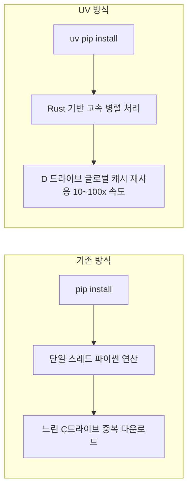
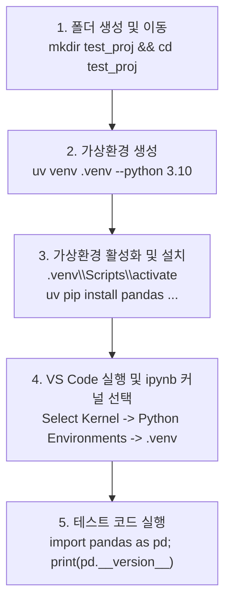
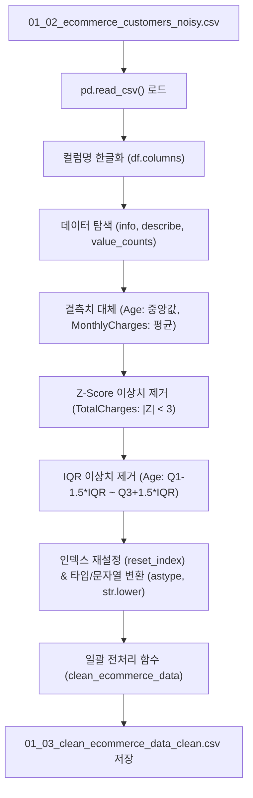
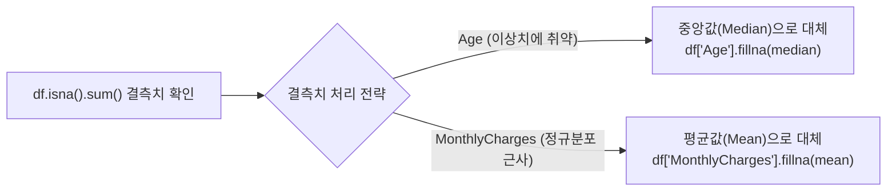

# [종합 기술 보고서] UV 가상환경 구축 및 머신러닝 데이터 전처리 파이프라인 완벽 분석

> **작성일**: 2026-10-13  
> **대상 프로젝트**: `D:\pknu_202610\01_Machine_Learning`  
> **분석 대상 노트북**: `2day_Data_Preprocess\01_data_preprocessing.ipynb`  
> **목적**: 초고속 패키지 관리자 **UV**를 활용한 머신러닝 가상환경 세팅 완벽 가이드 및 실제 작성된 **데이터 전처리 전체 노트북의 셀별 로직·수학적 원리·코드 심층 분석**

---

## 📑 목차
1. **[Part 1] 초고속 파이썬 패키지 매니저 UV 개발 환경 구축 완전 가이드**
   - 1.1 UV란 무엇인가? (기존 pip vs UV 비교 & KTX 비유)
   - 1.2 윈도우 환경 설치 및 D드라이브 캐시 경로 설정 원리
   - 1.3 가상환경(.venv) 생명주기 관리 (생성, 활성화, 패키지 설치, 삭제)
   - 1.4 환경 동결(`requirements.txt`)과 이식(재현)
   - 1.5 [실습] `test_proj` 프로젝트 폴더 구축 및 VS Code 커널 연결 5단계
2. **[Part 2] 데이터 전처리 파이프라인(01_data_preprocessing.ipynb) 셀별 심층 분석**
   - 2.1 전체 전처리 파이프라인 아키텍처 (Mermaid 흐름도)
   - 2.2 Phase 1: 개발 vs 데이터 분석 라이프사이클 및 기본 개념
   - 2.3 Phase 2: 데이터셋 로드 및 컬럼명 한글 표준화
   - 2.4 Phase 3: 탐색적 데이터 분석(EDA) 및 대용량 청크 샘플링
   - 2.5 Phase 4: 결측치(Missing Value) 탐지 및 대표값 대체 전략
   - 2.6 Phase 5: 이상치(Outlier) 탐지 2대 기법 비교 (Z-Score vs IQR)
   - 2.7 Phase 6: 인덱스 재정렬, 타입 변환 및 문자열 정제
   - 2.8 Phase 7: 전처리 파이프라인 모듈화(`clean_ecommerce_data`) 및 CSV 저장
3. **[Part 3] 실무 핵심 실수 방지 Q&A 및 체크리스트**
   - 3.1 `df = ` vs `df["컬럼"] = ` 의 치명적 차이
   - 3.2 이상치 제거 후 재실행 시 Z-Score가 다시 3을 넘는 원리
   - 3.3 `isna()`와 `isnull()`의 진실

---

# Part 1. 초고속 파이썬 패키지 매니저 UV 개발 환경 구축 완전 가이드

## 1.1 UV란 무엇인가?

> [!TIP]
> **🚄 찰떡 비유: 완행 디젤 열차(pip) vs 초고속 자기부상열차(UV)**  
> * **기존 `pip`**: 패키지를 설치할 때마다 하나씩 인터넷에서 다운로드하고, 의존성을 파이썬 코드로 느릿느릿 계산하며 조립하는 완행열차입니다.
> * **Astral의 `uv`**: 초고성능 시스템 언어인 **Rust(러스트)**로 제작되어, 병렬 다운로드와 글로벌 하드링크 캐시를 활용해 기존 `pip` 대비 **10배 ~ 100배 빠른 속도**로 패키지를 설치·관리하는 차세대 패키지 매니저입니다.



---

## 1.2 윈도우 환경 설치 및 환경변수 설정

### 1단계: 윈도우 PowerShell 실행 후 UV 설치
PowerShell을 관리자 또는 일반 권한으로 열고 다음 스크립트를 실행합니다:
```powershell
powershell -ExecutionPolicy ByPass -c "irm https://astral.sh/uv/install.ps1 | iex"
```
* **명령어 해설**:
  * `irm (Invoke-RestMethod)`: Astral 공식 사이트에서 설치용 스크립트(`install.ps1`)를 다운로드합니다.
  * `iex (Invoke-Expression)`: 다운로드한 설치 스크립트를 즉시 파워셸 메모리 상에서 실행합니다.

### 2단계: 설치 확인
새 터미널(또는 명령 프롬프트)을 열고 버전을 확인합니다:
```cmd
uv --version
```

### 3단계: UV 캐시 디렉터리 D 드라이브 이전 (C 드라이브 용량 방어)
기본적으로 머신러닝 라이브러리(PyTorch, TensorFlow, Scikit-learn 등)는 기가바이트(GB) 단위의 캐시 파일을 생성합니다. C 드라이브 용량이 부족한 경우, 글로벌 캐시 위치를 D 드라이브로 영구 지정합니다.

```powershell
[Environment]::SetEnvironmentVariable("UV_CACHE_DIR", "D:\.uv_cache", "User")
```
* **동작 원리**: 윈도우 사용자 환경변수에 `UV_CACHE_DIR=D:\.uv_cache`를 영구 등록하여, UV가 다운로드하는 모든 휠(wheel) 아카이브를 D 드라이브에 저장하고 하드링크를 걸어 디스크를 절약합니다.

---

## 1.3 가상환경(.venv) 생명주기 관리

> [!NOTE]
> **🏠 찰떡 비유: 독립된 연구실(가상환경)**  
> 머신러닝 프로젝트마다 필요한 패키지 버전이 다릅니다. 가상환경은 내 컴퓨터의 메인 시스템(전역 환경)을 더럽히지 않고, 방마다 독립된 벽을 쳐서 안전하게 실험 도구를 보관하는 **'독립 연구실'**입니다.

### 1) 작업 디렉터리 이동
```cmd
D:
cd D:\pknu_202610\01_Machine_Learning
```

### 2) 파이썬 3.10 기반 가상환경 생성
```cmd
uv venv .venv --python 3.10
```
* **왜 파이썬 3.10인가?**: 최신 파이썬(3.13, 3.14 등)은 머신러닝의 핵심 C-Extension 패키지(예: Scikit-learn, XGBoost, TensorFlow)의 빌드 호환성이 아직 검증되지 않은 경우가 많습니다. **3.10 또는 3.11**이 현재 머신러닝 생태계에서 가장 안정적인 표준(LTS 성격)입니다.

### 3) 가상환경 진입 (활성화, Activate)
```cmd
.venv\Scripts\activate
```
* 터미널 프롬프트 앞에 **`(.venv)`** 표식이 붙으면 정상 진입한 것입니다:
  `(.venv) D:\pknu_202610\01_Machine_Learning>`

### 4) 머신러닝 필수 패키지 고속 설치
```cmd
uv pip install ipython jupyter notebook xlrd lxml matplotlib seaborn pyarrow openpyxl selenium folium plotly scikit-learn xgboost lightgbm
```
* **패키지 분류**:
  * **주피터 코어**: `ipython`, `jupyter`, `notebook`
  * **데이터 핸들링/파일 I/O**: `pyarrow` (고속 데이터 처리), `openpyxl`, `xlrd`, `lxml`
  * **시각화 (EDA)**: `matplotlib`, `seaborn`, `plotly` (인터랙티브 시각화), `folium` (지도 시각화)
  * **크롤링/수집**: `selenium`
  * **머신러닝 3대장**: `scikit-learn` (전통 ML/전처리), `xgboost` (트리 부스팅), `lightgbm` (초고속 대용량 부스팅)

### 5) 가상환경 비활성화 및 삭제
* **가상환경 나가기**:
  ```cmd
  deactivate
  ```
* **가상환경 완전 삭제**: 가상환경은 복잡한 설치 마법사 없이 **`.venv` 폴더 하나를 통째로 삭제**하면 흔적도 남지 않고 깨끗이 제거됩니다.

---

## 1.4 환경 동결(`freeze`)과 완벽한 이식

팀원과 협업하거나 서버로 배포할 때, 현재 설치된 패키지와 정확한 버전 목록을 명세서로 만듭니다.

```cmd
# 1. 설치된 패키지 명세서 추출 (백업)
uv pip freeze > requirements.txt

# 2. 다른 컴퓨터나 새 가상환경에서 동일하게 복원 설치
uv pip install -r requirements.txt
```

---

## 1.5 [실습] `test_proj` 프로젝트 구축 5단계 로드맵

요청하신 실습 과제를 순서대로 수행하는 표준 가이드입니다:



1. **디렉터리 생성 및 이동**:
   ```cmd
   mkdir test_proj
   cd test_proj
   ```
2. **가상환경 생성**:
   ```cmd
   uv venv .venv --python 3.10
   ```
3. **가상환경 활성화 및 패키지 설치**:
   ```cmd
   .venv\Scripts\activate
   uv pip install pandas ipython jupyter matplotlib scikit-learn
   ```
4. **VS Code에서 커널 지정**:
   * VS Code에서 `test_proj` 폴더를 열고 `test.ipynb` 생성
   * 우측 상단의 **[Select Kernel]** 클릭 $\rightarrow$ **[Python Environments...]** $\rightarrow$ 현재 폴더의 **`.venv (Python 3.10.x)`** 선택
5. **검증 코드 실행**:
   ```python
   import pandas as pd
   print("Pandas 버전:", pd.__version__)
   print("가상환경 세팅 성공!")
   ```

---

# Part 2. 데이터 전처리 파이프라인(01_data_preprocessing.ipynb) 셀별 심층 분석

이 장에서는 실제 작성된 노트북(`01_data_preprocessing.ipynb`, 총 51개 셀)의 코드와 주석을 단계별로 하나도 빠짐없이 완벽 분석합니다.



---

## 2.1 Phase 1: 개발 vs 데이터 분석 라이프사이클 및 기본 개념 (Cell 0 ~ 2)

### 📌 셀 0: 개발 프로세스 vs 데이터 분석 프로세스 비교
```text
개발 방법 : 기획 -> 요구분석 -> 설계 -> 구현 -> 테스트 -> 운영(서비스)
분석 방법 : 계획 -> 데이터 수집 -> 데이터 전처리(1차/2차) -> EDA -> 후처리 -> 모델링 -> 평가 -> 서비스화(MLOps)
```
* **핵심 로직**: 전통적인 소프트웨어 개발은 **규칙(Rule)을 코드로 구현**하는 것이 목적이지만, 머신러닝 데이터 분석은 **데이터로부터 규칙을 학습(Learning)**하는 과정이므로 데이터 정제(전처리)와 EDA가 프로젝트 성공의 80%를 좌우합니다.

### 📌 셀 1: 데이터 종류 및 머신러닝 기초 용어
* **정형 데이터**: 엑셀 표, RDBMS처럼 행(Row)과 열(Column)로 정형화된 데이터.
* **반정형 데이터**: HTML, XML, JSON처럼 구조는 있으나 행렬 형태는 아닌 데이터.
* **비정형 데이터**: 이미지, 음성, 텍스트(자연어), 동영상 등 규칙적인 구조가 없는 데이터.
* **지도학습(Supervised)**: 문제($X$, 독립변수)와 정답($y$, 종속변수)을 모두 주고 학습시킴.
  * **회귀(Regression)**: 예측 대상이 **연속적인 숫자** (예: 집값, 매출액, 총 요금).
  * **분류(Classification)**: 예측 대상이 **범주/라벨** (예: 고객 이탈 여부 0/1, 스팸 메일 여부).
* **비지도학습(Unsupervised)**: 정답($y$) 없이 데이터의 패턴과 군집을 스스로 찾음 (예: 군집화, 차원 축소).
* **수학적 기본 방정식**:
  $$y = aX + b \quad (y: \text{종속변수}, X: \text{독립변수}, a: \text{기울기/가중치}, b: \text{절편/편향})$$

---

## 2.2 Phase 2: 데이터셋 로드 및 컬럼명 한글 표준화 (Cell 3 ~ 8)

### 📌 셀 3: 라이브러리 임포트
```python
import pandas as pd
```
* `pandas`의 기능을 `pd`라는 관례적 네임스페이스로 임포트합니다.

### 📌 셀 4 ~ 7: 상대경로 기반 CSV 읽기
```python
df = pd.read_csv('./dataset/01_02_ecommerce_customers_noisy.csv')
df.head()
```
* **상대경로 (`./dataset/`)**: 소스 코드가 위치한 폴더를 기준으로 경로를 지정하여 다른 컴퓨터로 프로젝트를 옮겨도 코드가 깨지지 않도록 보장합니다.
* **`pd.read_csv()`**: CSV 텍스트 파일을 파싱하여 판다스의 표준 2차원 자료구조인 `DataFrame`으로 자동 변환합니다.

### 📌 셀 8: 컬럼명 한글 직관적 변경
```python
df.columns = [
    '고객 고유 식별자', '고객 나이', '고객 성별', '가입 기간_월단위', 
    '월 평균 결제액', '총 결제액', '고객센터 문의 횟수', '리뷰 평균 점수', '이탈 여부'
]
df
```
* **로직 분석**: 영문 컬럼명 9개를 순서대로 한글 명칭으로 통째로 교체합니다. 현업 보고용이거나 도메인 이해를 도울 때 직관적이지만, 개수가 9개와 정확히 일치해야 합니다.

---

## 2.3 Phase 3: 탐색적 데이터 분석(EDA) 및 대용량 샘플링 (Cell 9 ~ 17)

### 📌 셀 10, 15: `df.info()`를 통한 결측치 및 타입 1차 진단
```python
df.info()
```
* 전체 행 수(`5000 entries`)와 각 컬럼의 `Non-Null Count`를 대조하여 결측치가 존재하는지 즉시 파악합니다.
  * `Age`: 4950 non-null (50건 결측치 발견)
  * `MonthlyCharges`: 4970 non-null (30건 결측치 발견)

### 📌 셀 12, 15: `df.describe()` 기초 통계 분석
```python
df.describe() # 수치형 컬럼 요약 (평균, 표준편차, min, 25%, 50%, 75%, max)
df.describe(include=["int", "float", "object"]) # 문자열(object) 컬럼까지 포함
```
* **이상치 단서 포착**: `TotalCharges`의 `max` 값이 수십만 달러에 달하여 평균(mean)을 심각하게 왜곡하고 있음을 감지합니다.

### 📌 셀 14: 대용량 데이터 전처리 기법 (Chunksize & Usecols)
```python
# 1. 1000개 단위로 쪼개어 읽어오는 Generator 생성
df_temp = pd.read_csv(file_path, chunksize=1000)
df_temp = next(df_temp) # 첫 번째 청크(1,000건)만 메모리에 로드

# 2. 메모리 절약을 위해 분석에 필요한 컬럼만 선택 로드
df_temp = pd.read_csv(file_path, usecols=["CustomerID", "Age", "Gender"])
```
* **실무적 의의**: 수십 기가바이트의 빅데이터는 한 번에 RAM에 올리면 OOM(Out of Memory) 에러가 발생합니다. `chunksize`와 `usecols`는 데이터를 분할 처리하거나 경량화하는 실무 핵심 기법입니다.

### 📌 셀 17: 범주형 데이터 고유값 빈도 분석 (`value_counts`)
```python
chrun_cnt = df["Churn"].value_counts(normalize=True)
gender_cnt = df["Gender"].value_counts(normalize=True)
```
* `normalize=True` 옵션을 주어 각 범주가 차지하는 **비율(0.0 ~ 1.0)**을 계산합니다.
* 타겟 변수(`Churn`)의 클래스 불균형(Imbalanced Data) 여부를 확인하는 필수 단계입니다.

---

## 2.4 Phase 4: 결측치(Missing Value) 탐지 및 대체 전략 (Cell 18 ~ 22)



### 📌 셀 20: 결측치 수량 확인
```python
df.isna().sum()
```
* `isna()`로 결측 칸에 `True(1)`를 마킹하고, 컬럼별 세로 합(`sum()`)을 계산하여 누락 개수를 집계합니다.

### 📌 셀 21: `Age` 결측치를 중앙값(Median)으로 대체
```python
age_median = df["Age"].median()
df["Age"] = df["Age"].fillna(age_median)
```
* **왜 평균이 아니라 중앙값인가?**: 나이 데이터는 극단적인 값(예: 120세, -5세 등 노이즈)이 섞여 있을 경우 평균이 왜곡됩니다. 따라서 이상치에 영향을 덜 받는 **중앙값(50% 분위수)**을 대표값으로 채택했습니다.

### 📌 셀 22: `MonthlyCharges` 결측치를 평균값(Mean)으로 대체
```python
MC_Mean = df["MonthlyCharges"].mean()
df["MonthlyCharges"] = df["MonthlyCharges"].fillna(MC_Mean)
```
* 월 결제 요금은 비교적 완만한 분포를 보이므로 산술 평균으로 결측치를 보간했습니다.

---

## 2.5 Phase 5: 이상치(Outlier) 탐지 2대 기법 비교 (Cell 23 ~ 31)

### 📌 1) 회귀용 기법: Z-Score (TotalCharges 이상치 제거, Cell 26 ~ 28)

$$Z = \frac{|X - \mu|}{\sigma} \quad (\mu: \text{평균}, \sigma: \text{표준편차})$$

```python
import numpy as np

# 1. Z-Score 표준화 거리 계산
z_score = np.abs((df["TotalCharges"] - df["TotalCharges"].mean()) / df["TotalCharges"].std())

# 2. 신뢰구간 약 99.7% 바깥의 극단치(|Z| >= 3) 제거
df = df[z_score < 3]
```
* **로직 분석**:
  * 평균으로부터 표준편차의 몇 배만큼 떨어져 있는지를 계산합니다.
  * 정규분포에서 $\pm 3\sigma$ 범위는 전체 데이터의 약 99.73%를 커버합니다. 따라서 $Z \ge 3$인 데이터는 0.27%에 불과한 '극단적 이상치'로 간주하여 필터링합니다.
* **왜 TotalCharges에 적용했는가?**: 원본 데이터 0, 1, 2번 행의 `TotalCharges`는 47만, 71만 달러로 일반 고객(수천 달러)보다 100배 큰 거대 노이즈였습니다. 이 값은 회귀 직선의 기울기를 왜곡시키는 주범이므로 Z-Score를 통해 말끔히 제거(5,000건 $\rightarrow$ 4,992건)했습니다.

---

### 📌 2) 분류용 기법: IQR (Age 이상치 제거, Cell 29 ~ 31)

> [!NOTE]
> **📦 찰떡 비유: 박스플롯(Box Plot)의 울타리**  
> 학생들을 키 순서대로 줄 세운 뒤, 정확히 가운데 50%의 학생들(Q1 ~ Q3)의 키 차이(`IQR`)를 잽니다. 이 폭의 1.5배만큼 앞뒤로 울타리를 쳐서, 울타리를 벗어난 학생만 이상치로 판단합니다.

$$IQR = Q3 - Q1$$
$$\text{Lower Bound} = Q1 - 1.5 \times IQR$$
$$\text{Upper Bound} = Q3 + 1.5 \times IQR$$

```python
# 1. 제1사분위수(25%) 및 제3사분위수(75%) 계산
Q1 = df["Age"].quantile(0.25)
Q3 = df["Age"].quantile(0.75)
IQR = Q3 - Q1

# 2. 울타리(경계값) 설정
lower_bound = Q1 - 1.5 * IQR
upper_bound = Q3 + 1.5 * IQR

# 3. 경계값 내부의 정상 데이터만 추출
df = df[(df["Age"] >= lower_bound) & (df["Age"] <= upper_bound)]
```
* **로직 분석**: 평균과 표준편차를 사용하지 않고 **순서 기반(분위수)**으로 계산하므로, 극단적인 값의 크기에 영향을 받지 않는 매우 견고한(Robust) 이상치 제거 방법입니다.

---

## 2.6 Phase 6: 인덱스 재정렬, 타입 변환 및 문자열 정제 (Cell 32 ~ 36)

### 📌 셀 33: 인덱스 번호 재설정 (`reset_index`)
```python
df.reset_index(inplace=True, drop=True)
```
* **로직 분석**: 이상치 행들이 삭제되면서 `0, 1, 2`번이 빠지고 인덱스가 `3, 9, 10...`처럼 구멍이 났습니다. `drop=True`로 기존 번호표를 날려버리고 `0, 1, 2...` 순차적 인덱스를 새로 부여합니다.

### 📌 셀 35: 데이터 타입 다운캐스팅 (`astype`)
```python
df["Age"] = df["Age"].astype("int")
```
* **로직 분석**: 결측치가 들어있던 컬럼은 판다스 특성상 강제로 `float64`로 승격됩니다. 결측치를 채웠으므로 사람이 읽기 편하고 메모리를 절약할 수 있도록 원래의 정수형(`int`)으로 변환합니다.

### 📌 셀 36: 문자열 소문자 표준화 (`str.lower()`)
```python
df["Gender"] = df["Gender"].str.lower()
```
* **로직 분석**: `'Male'`, `'male'`, `'MALE'`처럼 대소문자가 혼용되어 범주가 분열되는 현상을 방지하기 위해 판다스 문자열 벡터화 접근자(`.str`)를 사용하여 일괄 소문자로 정규화합니다.

---

## 2.7 Phase 7: 전처리 파이프라인 모듈화 및 파일 저장 (Cell 37 ~ 51)

개별 셀에서 실습한 모든 전처리 과정을 재사용 가능한 단일 함수로 캡슐화했습니다.

### 📌 셀 50: `clean_ecommerce_data` 파이프라인 함수
```python
def clean_ecommerce_data():
    # 1. 원본 데이터 로드
    file_path = "./dataset/01_02_ecommerce_customers_noisy.csv"
    df = pd.read_csv(file_path)

    # 2. 결측치 대체
    age_median = df["Age"].median()
    df["Age"] = df["Age"].fillna(age_median)

    mc_mean = df["MonthlyCharges"].mean()
    df["MonthlyCharges"] = df["MonthlyCharges"].fillna(mc_mean)

    # 3. Z-Score 기반 이상치 제거 (TotalCharges)
    z_score = np.abs((df["TotalCharges"] - df["TotalCharges"].mean()) / df["TotalCharges"].std())
    df = df[z_score < 3]

    # 4. IQR 기반 이상치 제거 (Age)
    Q1 = df["Age"].quantile(0.25)
    Q3 = df["Age"].quantile(0.75)
    IQR = Q3 - Q1
    lower_bound = Q1 - 1.5 * IQR
    upper_bound = Q3 + 1.5 * IQR
    df = df[(df["Age"] >= lower_bound) & (df["Age"] <= upper_bound)]

    # 5. 인덱스 초기화 및 자료형/문자열 정제
    df.reset_index(inplace=True, drop=True)
    df["Age"] = df["Age"].astype("int")
    df["Gender"] = df["Gender"].str.lower()

    # 6. 정제된 최종 데이터프레임 반환
    return df
```

### 📌 셀 51: 전처리 결과 CSV 영구 저장
```python
save_path = "./dataset/01_03_clean_ecommerce_data_clean.csv"
clean_ecommerce_data().to_csv(save_path)
```
* **로직 분석**: 파이프라인을 가동하여 결측치와 이상치가 모두 해결되고 포맷이 정제된 깨끗한 데이터셋을 파일로 출력합니다. 이후 머신러닝 모델 학습 셀에서는 이 정제된 파일을 읽어 사용하게 됩니다.

---

# Part 3. 실무 핵심 실수 방지 Q&A 및 체크리스트

### Q1. `df = df[...]` 와 `df["컬럼"] = ...` 의 치명적 차이는 무엇인가요?
* **`df["컬럼"] = ...` (세로 기둥 하나만 수정)**:
  * 예: `df["Age"] = df["Age"].fillna(...)`
  * 행(사람)은 그대로 두고 특정 칸의 내용물만 바꿉니다. 만약 여기에 조건식(`(df['Age'] >= 20)`)을 대입하면 **기존 나이 데이터가 날아가고 `True/False` 불리언 값으로 덮어써지는 대참사**가 발생합니다.
* **`df = df[...]` (가로 줄 전체를 필터링하여 표 재구성)**:
  * 예: `df = df[z_score < 3]`
  * 조건에 부합하지 않는 사람(행)을 명부에서 완전히 제거하여 표 전체의 크기를 줄입니다.

---

### Q2. 이상치 제거 코드를 실행했는데, 왜 또 3보다 큰 Z-Score가 보이나요?
* **원인**: 이상치가 제거된 데이터(4,992개)를 대상으로 주피터 셀을 **2번 이상 재실행**했기 때문입니다.
* **원리**: 47만 달러짜리 거대 이상치가 나간 뒤 남은 일반인들끼리 평균과 표준편차를 **다시 계산**하면, 표준편차가 확 줄어들면서 정상 범위의 경계선이 좁아집니다. 그 결과 아까는 통과했던 데이터가 새로운 기준표에서 또다시 $Z > 3$으로 걸려버리는 것입니다.
* **해결책**: 이상치 필터링 코드는 딱 한 번만 수행해야 하며, 셀이 꼬였다면 맨 위 CSV 로드 셀부터 차례대로 재실행해야 합니다.

---

### Q3. `isna()`와 `isnull()`은 어떤 차이가 있나요?
* **완전히 동일합니다 (100% 쌍둥이 함수)**.
* 통계 언어 R 출신 개발자들을 위한 `isna()`(Not Available)와 데이터베이스 SQL 출신 개발자들을 위한 `isnull()`(Null)을 판다스 제작자가 둘 다 똑같은 기능의 별칭(Alias)으로 지원하는 것입니다. 편한 것을 사용하시면 됩니다.

---

## 🎯 종합 결론 및 향후 로드맵
1. **개발 환경의 표준화**: `uv`를 통해 D 드라이브에 안전하고 빠른 격리 가상환경을 구축하고 `requirements.txt`로 재현성을 확보했습니다.
2. **데이터 전처리 파이프라인 완성**: 지저분한 원본 CSV(`01_02...noisy.csv`)로부터 **결측치 대체 $\rightarrow$ Z-Score/IQR 복합 이상치 제거 $\rightarrow$ 타입 변환 $\rightarrow$ 파이프라인 함수화**를 완벽하게 구현하여 머신러닝 학습이 가능한 정제 데이터셋(`01_03...clean.csv`)을 생성했습니다.
3. **다음 단계**: 정제된 데이터를 바탕으로 독립변수($X$)와 종속변수($y$)를 분리하고, 훈련셋/테스트셋 분할(`train_test_split`) 후 본격적인 머신러닝 분류(예: Churn 예측) 및 회귀 모델링으로 연결하시면 됩니다.
